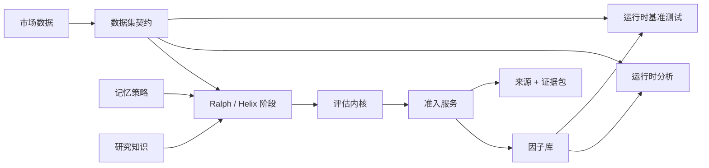

# FactorMiner

**一个受治理的研究引擎,用于发现、评估和文档化可解释的 alpha 因子。**

[](https://www.python.org/downloads/)
[](LICENSE)
[](https://github.com/minihellboy/factorminer/actions/workflows/ci.yml)

FactorMiner 将**类型化公式 DSL、LLM 引导的搜索、结构化记忆、严格的运行时重算、可审查的研究产物**组合在一起。它遵循论文 [*FactorMiner: A Self-Evolving Agent with Skills and Experience Memory for Financial Alpha Discovery*](https://arxiv.org/abs/2602.14670) 中描述的体系,并通过**显式的架构契约、更强的验证与模型无关的智能体集成接口**对其进行了扩展。

FactorMiner 是**研究基础设施**。它**提出并评估产物**;它**不**推荐交易、**不**决定仓位、**不**绑定风险限额、**不**路由订单、也**不**运营任何自主账户。

## 包含的内容

| 表面 | 用途 |
| --- | --- |
| 类型化 DSL 与算子注册表 | 在 OHLCV 与已注册的特征叶节点之上构建安全、可解释的公式 |
| `RalphLoop` | 论文规范的"生成 / 评估 / 进化"通道 |
| `HelixLoop` | 扩展检索、辩论、规范化与验证的通道 |
| 基于策略的记忆 | 论文风格、无记忆、KG、家族感知、制度感知、编辑感知等多种策略 |
| 运行时评估 | 在所提供的数据集上**重算**公式;保存的摘要不被视为真相 |
| 基准测试运行时 | Top-K 冻结、记忆/策略消融、CPCV/PBO、成本压力与效率评估 |
| 研究知识 | 持久化的已筛选来源与假设,附带有界检索与结果归因 |
| 证据包 | 不可变、基于内容寻址的因子证据,附带数据集/配置/代码哈希与完整性校验 |
| 研究扩展 | EDGAR / 期货数据、拥挤度、容量、敏感性、模型风险、来源产物 |
| 智能体网关 | MCP 服务器,以及插件与托管智能体的参考集成 |

内置目录包含 **110 个规范化的论文因子**。已命名的第三方基线**并非全部忠实复现**;manifest 会显式标注文献子集、代理实现、运行时循环与已保存的库。请在解读基准输出前查阅 [Reproducibility(中文)](docs/reproducibility-中文.md)。

## 安装

推荐贡献者使用 [uv](https://docs.astral.sh/uv/) 进行环境搭建:

```bash
git clone https://github.com/minihellboy/factorminer.git
cd factorminer
uv sync --group dev --all-extras
```

精简环境可用:

```bash
uv sync --group dev
uv sync --group dev --extra llm   # 添加托管 / 本地 LLM 提供商
uv sync --group dev --extra mcp   # 添加 MCP 服务器
```

可移植的默认后端是 **NumPy**。CUDA 额外项面向 Linux;请仅在 CUDA 可用的环境中使用 `--gpu`。pip 的可编辑安装同样可用:

```bash
python3 -m pip install -e ".[llm,mcp]"
```

## 快速上手

确定性演示与 mock 工作流**无需任何 API Key**:

```bash
uv run python scripts/run_demo.py
uv run factorminer quickstart
uv run factorminer doctor --json
```

`quickstart` 会在 `/tmp/factorminer-quickstart` 下生成小型因子库与静态报告。直接进行因子挖掘:

```bash
uv run factorminer -o /tmp/factorminer-run mine --mock -n 2 -b 8 -t 10
uv run factorminer session inspect /tmp/factorminer-run --telemetry
```

使用真实数据时,请**先校验 schema**:

```bash
uv run factorminer validate-data path/to/market_data.csv
uv run factorminer -c factorminer.local.yaml -o output-real \
  mine --data path/to/market_data.csv
```

面板数据最少的必需字段为:

```text
datetime, asset_id, open, high, low, close, volume, amount
```

`symbol`、`ticker`、`code`、`ts_code` 等标识符别名都会被接受。缺失的 `vwap` 与 `returns` 可由运行时层推导生成。

## 核心工作流

运行扩展的研究通道:

```bash
uv run factorminer --cpu helix --mock --debate --canonicalize -n 2 -b 8 -t 10
```

对已保存的因子库进行重算与评估:

```bash
uv run factorminer --cpu evaluate output/factor_library.json \
  --mock --period both --top-k 10
```

基于显式的拟合 / 评估划分构建组合:

```bash
uv run factorminer --cpu combine output/factor_library.json \
  --mock --fit-period train --eval-period test --method all \
  --selection lasso --top-k 20
```

运行基准测试或独立的 Phase 2 报告构建器:

```bash
uv run factorminer --cpu --config factorminer/configs/paper_repro.yaml \
  benchmark table1 --mock --baseline factor_miner
uv run factorminer --cpu benchmark ablation-strategy --mock \
  --baseline factor_miner
uv run python scripts/run_phase2_benchmark.py --mock
```

CLI 同样暴露了**数据校验 / 重采样、可视化、CPCV、组合构建、拥挤度与敏感性诊断、EDGAR / 期货附件、研究资料摄入、RFT 数据集导出、密封搜索、模型协同优化**以及 **MCP 传输**等能力。请以 `uv run factorminer --help` 与各命令的 `--help` 作为权威命令参考。

研究资料摄入会同时持久化**通过与未通过**的来源决策。通过的来源会生成一个基于内容寻址的假设,可在挖掘过程中检索,**而无需将原始文档放入 prompt**:

```bash
uv run factorminer -o output ingest-research path/to/note.txt --mock
uv run factorminer -o output verify-evidence
```

## 架构



两条循环共用同一套**经过验证的因子生成器、解析器、阶段契约、准入服务与策略持久化机制**。Helix 在不创建并行基准或记忆基础设施的前提下加入了更多组件。**架构层**负责可复用的契约与策略;**循环层应保持为编排层**。

关于契约、包归属与依赖方向,请参见 [Architecture(中文)](docs/architecture-中文.md)。

## 仓库布局

```text
factorminer/
├── factorminer/
│   ├── application/    类型化执行上下文与工作流契约
│   ├── architecture/   契约、策略、阶段、可复用服务
│   ├── core/           循环、DSL 解析器、表达式树、因子库、I/O
│   ├── domain/         无外部依赖的数值契约
│   ├── agent/          模型提供商、prompt、生成、辩论
│   ├── data/           加载器、预处理、连接器、张量构建
│   ├── evaluation/     重算、指标、校验、报告
│   ├── benchmark/      契约、数据集、运行器、统计、报告
│   ├── memory/         存储、检索、KG、嵌入
│   ├── operators/      类型化算子规格与执行后端
│   ├── mcp/            面向智能体的 MCP 服务器
│   └── tests/          回归与契约覆盖
├── integrations/       插件与托管智能体的参考部署
├── scripts/            演示、独立运行器、仓库校验
├── docs/               架构、可复现性、安全
└── data/               文档化的公开入门样本
```

`output/` 是可变运行时状态,被有意忽略。**仓库本地配置应放在单独的未跟踪文件中**,而非混入已发布的默认配置。

## 智能体与金融服务集成

FactorMiner 既可作为本地 stdio MCP 服务器运行,也可作为可选的鉴权 HTTP 服务器运行。参考性的 `factor-researcher` 集成将两种部署形态并列保留:

- `integrations/factor-researcher/plugin/`
- `integrations/factor-researcher/managed-agent/`

二者复用同一份系统 prompt 与技能。**外部数据服务由客户自行掌控**;FactorMiner 维持**仅供研究使用**的边界,并将产物返回供人工审核。配置步骤、连接器示例、权限与部署说明见 [integration guide(中文)](integrations/factor-researcher/README.md)。

## 文档

| 文档 | 内容范围 |
| --- | --- |
| [Architecture(中文)](docs/architecture-中文.md) | 运行时契约、依赖方向与包归属 |
| [Reproducibility(中文)](docs/reproducibility-中文.md) | 数据契约、指标、基线来源、公开与论文级工作流 |
| [Evidence protocol(中文)](docs/evidence-protocol-中文.md) | IC 定义、推断、风险中性化、成本压力与报告 schema |
| [Public evidence release(中文)](docs/public-evidence-release-中文.md) | 校验和锁定的公开数据、多 seed 运行、可移植发布与全新克隆验证 |
| [Design-partner pilot(中文)](docs/design-partner-pilot-中文.md) | 私有数据集承诺与有界外部致谢 |
| [Hosted pilot(中文)](docs/hosted-pilot-中文.md) | 租户隔离、限定范围 MCP、配额、保留、事件响应与基于同意的学习 |
| [Security(中文)](docs/security-中文.md) | 连接器、MCP、模型/内容边界、持久化、密钥 |
| [License](LICENSE) | 整个项目的 MIT 许可条款 |
| [Integration guide](integrations/factor-researcher/README.md) | 智能体打包、金融数据连接器、部署护栏 |
| [Contributing(中文)](CONTRIBUTING-中文.md) | PR 范围、检查项、归属与文档治理 |

## 开发

```bash
uv run ruff check .
uv run python scripts/check_architecture.py
uv run python scripts/check.py
uv run pytest -q factorminer/tests
uv build
```

关于专项测试命令、导入边界规则与 PR 期望,请参阅 [Contributing(中文)](CONTRIBUTING-中文.md)。

## 许可

FactorMiner 基于 **MIT License** 发布。完整许可文本见 [LICENSE](LICENSE)。