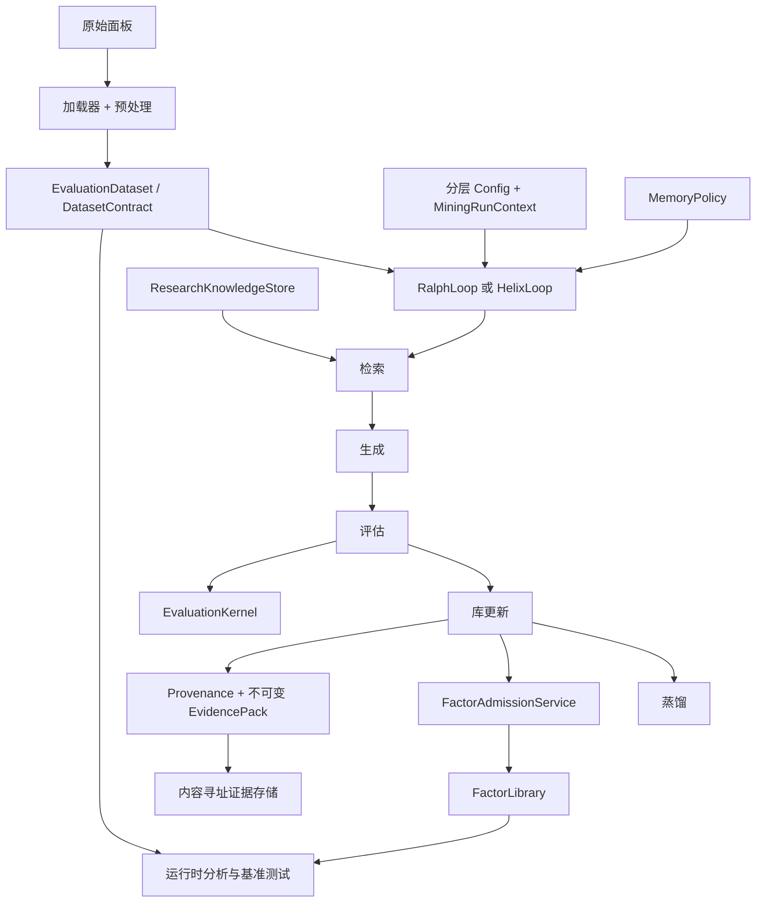

# 架构(Architecture)

FactorMiner 将**研究协议、编排、执行、持久化与集成**的关注点分离,从而改进时不会分裂科学契约。本文档持有这些边界。关于指标与基准语义,请参见 [Reproducibility(中文)](reproducibility-中文.md);关于信任边界,请参见 [Security(中文)](security-中文.md)。

## 系统形态



权威规则很简单:**已保存的因子摘要是有用的元数据**,但分析与基准测试都会在所提供的数据集上**重新计算**公式信号。**数据集、划分、目标、指标、基线来源**始终随产物一起携带。

## 领域与应用契约

数值领域语义位于编排之下,且**不**导入 application 或 interface 代码。可复用的工作流语义位于 `factorminer/architecture/`,**不**放在 CLI 处理器或循环特定的分支里。

| 契约 | 模块 | 职责 |
| --- | --- | --- |
| 运行上下文 | `application/runtime_context.py` | 输出位置、物化的目标、每次运行的显式覆写 |
| 循环执行 | `core/loop_services.py` | 共享的 retrieve / generate / evaluate / update / distill 序列与遥测 |
| 挖掘服务 | `application/mining_budget.py`、`validation_pipeline.py`、`mining_reporting.py` | 资源核算、评估编排、报告 |
| 运行产物 | `application/run_artifacts.py`、`evidence_service.py` | manifest、来源挂载、证据构造、存储与校验 |
| 证据 | `domain/evidence.py` | 不可变 JSON 值、证据身份、证明状态、完整性校验 |
| 论文协议 | `paper_protocol.py` | 目标、阈值、替换、Top-K 冻结、产物契约 |
| 数据集 | `dataset_contract.py` | 形状、目标栈、划分感知的运行时描述 |
| 评估 | `evaluation_kernel.py` | 候选打分与冗余/替换决策 |
| 依赖性 | `domain/dependence.py` | Spearman、Pearson、距离相关与跨度诊断 |
| 几何 | `geometry.py` | 饱和度、候选/库依赖、替换资格 |
| 记忆 | `memory_policy.py` | 检索、形成、演化、持久化、恢复 |
| Prompt | `prompt_context.py` | 把记忆/库状态类型化转换为生成上下文 |
| 生命周期 | `lifecycle.py` | 提议、拒绝、准入与蒸馏轨迹 |
| 阶段 | `stages.py` | retrieve/generate/evaluate/update/distill 接口 |
| 准入 | `library_services.py` | 因子库的变更边界 |
| Phase 2 构造 | `phase2_services.py` | 可选 Helix 组件工厂与更新服务 |
| 研究规划 | `research_absorption.py`、`research_planner.py`、`application/research_knowledge.py` | 来源筛选、持久假设、有界检索、路由与结果归因 |
| 实验搜索 | `island_model.py`、`sealed_joint_search.py` | 可选的种群与多评估器模式 |
| 训练导出 | `rft_export.py` | 带 reward 标注的离线数据集;**不**在进程中训练模型 |

## 挖掘通道(Ralph / Helix)

`RalphLoop` 与 `HelixLoop` 共享:

- 已校验的 `agent.factor_generator.FactorGenerator` 路径;
- 结构化输出解析、修复、级联与 prompt-cache 行为;
- 阶段契约与因子准入服务;
- 基于策略的记忆检索与持久化;
- 生命周期/来源记录与检查点约定。

`RalphLoop` 是论文规范的通道。它编排一个有界的"生成/评估/进化"运行,并将科学规则委托给架构层服务。

`HelixLoop` 在同一外层序列中替换为更丰富的实现。它可以加入:KG 或嵌入检索、辩论、规范化、语义去重、准入后验证、在线遗忘、Phase 2 更新。这些都是**可选组件**,而不是第二套协议。

两条循环都通过同一 Ralph 初始化路径构造 `FactorGenerator`、`MemoryPolicy`、`LoopExecutionService`、`MiningArtifactService` 与 `ResearchKnowledgeStore`。Helix 仅替换**命名阶段的实现**与**可选的验证服务**。循环中**不存在**独立的因子生成器、记忆管理器或基准引擎。

## 数据与表达式执行

正常的数据路径为:

```text
DataFrame / 加载器
  → 预处理与 schema 规范化
  → 张量构建器
  → EvaluationDataset + DatasetContract
  → 挖掘、分析或基准运行时
```

`utils.config.Config` 是可复用的配置源。`MiningRunContext` 持有执行特定的状态,如输出路径与已物化的目标面板;循环通过只读的 `MiningSettings` 视图读取分层段。DataFrame 输入用 `load_runtime_dataset`;已经对齐的数值面板用 `build_runtime_dataset_from_arrays`。

规范的公式叶子包括 `$open`、`$high`、`$low`、`$close`、`$volume`、`$amt`、`$vwap`、`$returns`。特征注册表可加入**作用域受限**的叶子(如点-in-time EDGAR 基本面或期货属性)。公式被解析为表达式树,通过类型化算子和所选后端(`numpy`/`c`/`gpu`)执行。

划分边界来自 `data.train_period` 与 `data.test_period`。`evaluate`、`combine`、`visualize` 与基准路径都消费同一运行时划分模型。

## 记忆与检索

每个 `MemoryPolicy` 都声明其 schema,并持有检索、形成、演化、序列化与恢复。

| 策略 | 角色 |
| --- | --- |
| `paper` | 论文通道使用的扁平成功/失败/insight 经验 |
| `none` | 记忆消融 |
| `kg` | 知识图谱与混合词法/稠密检索 |
| `family_aware` | 引导向家族缺口,远离饱和 |
| `regime_aware` | 在检测到的市场状态下条件化上下文 |
| `edit_aware` | 父→子 AST 编辑信用与 veto 记忆 |

`FactorFamilyDiscovery` 提供细粒度的公式类别与更粗糙的机制分类法。Prompt 构建器接收**摘要**,而非原始可变存储。Edit-aware 记忆接收循环给出的真实父代与第二亲代谱系。

外部研究是与经验记忆**分离**的数据平面。`ResearchKnowledgeStore` 在 `output/research_knowledge/` 之下写入:

- 内容寻址的 A 层来源决策;
- B/C 层假设;
- 每个候选的结果。

检索按"观察到的准入产出"与"未覆盖的公式家族"对存储的假设排序,用 `research.knowledge_retrieval_limit` 限制结果,仅注入**结构化的 archetype**。具体的 `source_ids` 与 `hypothesis_ids` 会复制到因子 provenance 与 evidence pack。

## 评估与准入

`EvaluationKernel` 计算候选证据。`LibraryGeometry` 汇总依赖与饱和度。`FactorAdmissionService` 是库的唯一正常变更路径,**包括跨岛迁入的因子**。

依赖性策略显式且可序列化:

- `spearman`
- `pearson`
- `distance_correlation`

evaluation 包还包含**可选**的研究诊断:显著性、CPCV/PBO、衰减、因果、拥挤度、容量、组合构造、公式敏感性、模型风险证据。这些诊断**不得**悄然改变规范准入。

## 基准运行时

基准包有**一条**执行路径,显式定义模块归属:

| 模块 | 职责 |
| --- | --- |
| `runtime.py` | 基准编排与公共运行函数 |
| `contracts.py` | 不可变 manifest、walk-forward、压力、策略网格契约 |
| `runtime_contracts.py` | 从有效配置与数据集状态构造运行时契约 |
| `provenance.py` | 目录、保存库、会话与产物的内容哈希与来源 |
| `mining_runtime.py` | Ralph/Helix 基准的配置、构造、执行与循环来源 |
| `datasets.py` | 数据集加载、配置投影、基线目录与库构造 |
| `frozen_evaluation.py` | 仅训练选择 + 持仓重算 |
| `statistics.py` | 结果契约与统计比较 |
| `runners.py` | live-loop Phase 2 组件消融 |
| `speed.py` | 算子与因子计时 |
| `reporting.py`、`phase2_reporting.py` | 严格产物、表格、manifest 与叙事渲染 |

这些模块共同实现:

- Table 1 风格的冻结 Top-K 评估;
- 记忆与策略网格消融;
- 交易成本压力;
- CPCV 与 Probability of Backtest Overfitting(PBO);
- 算子/因子效率;
- 套件运行器与机器可读的 manifest。

`scripts/run_phase2_benchmark.py` 是 `run_phase2_comparison`、`run_phase2_ablation_study` 与包内报告渲染器的**可执行组合层**。它**不**定义基准类或评估引擎。

## 持久化与产物

挖掘会话可以持久化:库、记忆载荷、循环状态、运行 manifest、生命周期账本、会话元数据、证据包、研究知识、可选的信号缓存。恢复是**策略特定**的。运行时报告与基准包标识:数据集、指标版本、协议、基线来源与相关配置。

每个被准入的因子都携带**一个或多个**证据 ID。`EvidencePack` 冻结:

- 公式 AST;
- 谱系;
- 划分指标;
- 失败证据;
- 成本/容量/制度/显著性/模型风险结果;
- 生成器身份;
- 数据/配置/代码哈希;
- 准入与替换决策;
- 来源归属;
- 证明状态;
- 显式的人工证明状态。

SHA-256 证据 ID 覆盖**规范化 payload**;`factorminer verify-evidence` 检测 payload 或文件名篡改。

`output/` 是可变运行时状态,**被 Git 忽略**。当前的本地产物目录既不可变也未签名。

## 归属与依赖方向

| 包 | 拥有 | 不得拥有 |
| --- | --- | --- |
| `domain` | 跨工作流共享的、无依赖的数值契约 | 编排、适配器或接口 |
| `application` | 类型化执行上下文与跨工作流的应用契约 | CLI 解析或数值领域语义 |
| `architecture` | 契约、策略、阶段、可复用研究服务 | CLI 解析或提供商特定 UI |
| `core` | 循环编排、DSL/解析器、表达式、库、会话 I/O | 并行基准或策略实现 |
| `agent` | 模型提供商、prompt、生成、辩论 | 指标/准入真相 |
| `data` | 摄取、规范化、连接器、张量构建 | 研究决策 |
| `evaluation` | 重算、指标、诊断、报告 | 循环编排 |
| `benchmark` | 对比契约、数据集、运行器、统计与报告 | 平行的循环基础设施 |
| `memory` | 存储、检索原语、KG、嵌入 | 循环特定的持久化策略 |
| `operators` | 类型化规格与执行后端 | 数据获取 |
| `mcp` | 窄外部工具/资源接口 | 核心研究逻辑 |

依赖方向是**可执行**的:domain 模块不能 import 更高层,适配器不能 import application 或 interface 层,application 模块不能 import CLI、MCP 或 benchmark 接口。`scripts/check_architecture.py` 在 CI 中强制执行这些规则。包的导出是**懒加载**的,在 `test_import_boundaries.py` 中回归测试;集成 manifest 与本地引用由 `scripts/check.py` 检查。