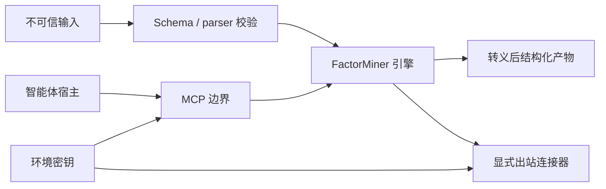

# 安全模型

FactorMiner 处理**不可信**的市场数据与模型生成的文本、启动有界子进程、可调用外部数据服务、且可暴露 MCP 工具接口。本文档定义当前对这些操作的**信任边界与强制控制**。

FactorMiner 是一个**研究引擎**。它的工具返回**研究产物**;它们**不**下单、不决定仓位、不绑定限额、不路由订单,也不运营账户。

## 资产与信任边界

受保护的资产包括:

- 提供商凭证;
- MCP bearer tokens;
- 已授权的市场数据;
- 所选输入/输出路径**之外**的本地文件;
- 研究产物;
- 评估结果的完整性。

将下列全部视为**不可信**数据:

- CSV、Parquet、HDF、Qlib 与连接器 payload;
- 保存的因子库与会话产物;
- 公式、理由、研究笔记与**所有** LLM 输出;
- MCP 工具参数与外部智能体 handoff;
- 远程 HTTP 响应与本地 OpenAI 兼容端点。

主要边界如下:



## 文件系统与子进程执行

MCP 引擎工具用**显式 argv 数组**委托给 `factorminer` CLI。它们**不使用** `shell=True`。被调用工作流接收显式的输入/输出路径,并返回捕获的结构化输出或包含返回码与诊断信息的错误。

`output/` 是可变的本地状态,**被 Git 忽略**。智能体 manifest 将托管输出限定在 `./out/`;参考托管集成中**只有** `librarian` 叶具有写权限工具。插件与托管智能体引用由 `scripts/check.py` 验证。

输入路径校验是格式特定的。连接器缓存键使用**规范化、已校验**的标识符,而非响应控制的路径片段。数据加载器**不**执行文件内容。

## 出站数据连接器

当前的出站表面为:

| 表面 | 数据 | 调用 |
| --- | --- | --- |
| `data/edgar_source.py` | SEC EDGAR XBRL facts | 显式 `attach-edgar` |
| `data/mcp_source.py` | 已配置的外部 MCP 表数据 | 显式 `fetch-data` |
| `evaluation/crowding.py` | 公开共识因子收益面板 | 显式 crowding 工作流 |
| `data/futures_source.py` | 连续期货输入变换 | 显式 `build-futures` |

网络抓取使用**显式超时**。EDGAR 访问固定为 `https://data.sec.gov`,应用响应大小限制,发送描述性 User-Agent,并将请求限速到 SEC 公平访问上限。点-in-time 连接使用**公告日**而非覆盖期结束日,因此事实**在公告前不可用**。

共识因子抓取**拒绝非 HTTPS URL**,强制响应大小上限,并在解析前验证内容/形状。畸形或不可用的数据产生**显式的 unavailable 结果**,而不是低风险默认值。

`MCPDataSourceConfig` 是**操作员控制**的 YAML。它在打开连接前校验 transport、必需连接字段、规范列覆盖、位置 schema 与未知键。`${ENV}` 展开允许凭证**保持在文件之外**。派生的 `amount = close * volume` 是 opt-in,被记录为**近似**而非观测成交额。

普通的 `mine` 与 `helix` 命令**不**触发无人值守的外部抓取。**获取与挂载**是分开的、显式的工作流。

## MCP 服务器

### Stdio

Stdio 是默认 transport。它是一个本地子进程管道,**不**增加网络监听器或应用认证层:

```bash
uv run factorminer mcp-serve --transport stdio
```

安全边界就是进程启动器与宿主机用户账户。

### HTTP

HTTP transport 是 opt-in。默认 host 为 `127.0.0.1`,除非配置好的 token 环境变量包含**非空**值,否则**启动失败**:

```bash
export FACTORMINER_MCP_TOKEN="$(openssl rand -hex 32)"
uv run factorminer mcp-serve \
  --transport http --host 127.0.0.1 --port 8765
```

客户端必须发送 `Authorization: Bearer <token>`。认证使用 MCP SDK 的 `TokenVerifier`/`AccessToken` 协议,经由 `StaticBearerTokenVerifier`。**没有**未鉴权的 HTTP 模式。

静态 bearer token 是**单操作员/可信网络**控制。它**不**提供用户身份、角色、租户隔离或每工具授权;**不要**把开发监听器暴露为公共的多租户服务。

单独的 `hosted-pilot serve` 表面增加**租户绑定**的限定凭证、持久的白名单作业、配额、保留与同意控制。其威胁模型与运维手册见 [Hosted pilot security and operations(中文)](hosted-pilot-中文.md)。本地服务器与托管服务器**绝不能**走同一公网端点。

每个工具描述说明其参数/结果形状与**仅供研究**的契约。工具函数返回**结构化 JSON**,**绝不**调用交易或券商端点。部署细节见[integration guide](../integrations/factor-researcher/README.md)。

## 本地/前沿模型级联

`OpenAICompatibleProvider` 把 prompt 发往**操作员配置**的 `base_url`。该 URL 从本地配置加载,**不能**由公式、LLM 响应、研究笔记或 MCP 请求提供。

强制凭证隔离:

- 缺失自定义 `base_url` → **错误**;
- 自定义 provider **不**回退到 `OPENAI_API_KEY`;
- 前沿 provider 构造时**剥除**自定义 `base_url`;
- 本地/draft 与前沿请求有**独立**的超时。

启用自定义端点 = **授予该端点对 draft 路径所发 prompt 内容的访问权**。操作员必须把该端点视为**数据处理器**,并用常规网络策略限制它。

## 公式与生成代码边界

默认的因子表面是**类型化 DSL**,不是任意 Python。输出被解析为表达式树,根据已注册叶子/算子进行校验,并通过**有界**的算子实现执行。解析失败与不支持的表达式**使评估失败**;运行时**不**用保存的分值替代。

LLM 文本**永不**传给 Python `eval` 或 `exec`。连接器与产物格式使用带 schema 检查的 JSON/YAML/表格解析器。算子沙箱与自定义算子路径必须保留同样的资源与语法限制。

## Prompt 与记忆注入

研究笔记与模型输出**只能**通过**结构化**边界再次进入后续模型上下文:

- 研究吸收产出**有界**的 `ResearchArchetype` 字段,而**不是**把原始文档拼接到生成 prompt 里;
- `PromptContextBuilder` 渲染**类型化**的记忆/库摘要;
- sealed 评估反馈**白名单**粗粒度字段,并把原始评估器内部细节**排除**在面向生成的上下文之外;
- 畸形评估器响应 → **中性/rejected**;
- 经济理由被附加到**被准入**因子上,**不**被视为系统指令。

这些控制**结构化**地分离了指令与数据。智能体 prompt 必须继续把连接器 payload、笔记、公式与保存的产物标记为**数据而非指令**。

## HTML 与报告渲染

公式名、理由、叙事字段与模型撰写的文本在插入 HTML 报告前用 `html.escape` 转义。经济理由**未经认证**前一律标记为 `UNATTESTED -- LLM DRAFT, NOT REVIEWED`。

静态报告生成**不**执行嵌入的模型输出。回归测试包含字面的 `<script>` payload 并断言输出已转义。

## 评估完整性

安全包括**防止误导性的研究产物**:

- 运行时分析**重算**所选数据集上的公式;
- 训练/测试边界显式且在分析路径间共享;
- 点-in-time 基本面连接使用**可用日期**;
- proxy 与部分基线**在 manifest 中标注**;
- sealed 多评估器模式对外暴露**一致性摘要**,**不**暴露评分内部;
- 不可用的诊断**保持不可用**,**不**默认为"安全"标签。

这些控制限制了**过期分值复用、前瞻偏差、来源歧义、奖励博弈**。它们**不**把回测变成投资建议。

## 密钥与持久化

API key 与 bearer token 应放在环境变量或**经批准**的密钥库中。它们**不能**出现在以下位置:

- 入 Git 的 YAML;
- 经常被记录到日志的 CLI 参数;
- 报告;
- 会话状态;
- RFT JSONL;
- 基准 manifest。

当前持久化表面存储:公式、指标、策略、轨迹元数据、哈希、奖励与配置投影——**不**包括提供商密钥。RFT 导出记录 `trains_model: false`;它**只产出数据集**,**不**启动模型训练。

## 模型序列化

FactorMiner 在进程中训练可选的小模型,且**不**对外部 checkpoint 调用 `torch.load`。因此 Python-pickle 检查点执行面在当前运行时**不存在**。外部序列化的模型对象**不接受**为 CLI/MCP 输入。

## 验证

下列检查强制执行本文档的关键不变量:

| 控制 | 覆盖 |
| --- | --- |
| HTTP 需要 token 且默认 loopback | MCP 服务器测试 |
| 工具描述保留"仅供研究"文本 | MCP 测试与 CI 兼容环境下的 live stdio smoke |
| 连接器超时、大小上限、畸形输入与点-in-time 连接 | data/crowding 回归测试 |
| 自定义 provider 不读前沿凭证 | LLM 接口测试 |
| Sealed 反馈排除评估器内部 | sealed-search 测试 |
| HTML 转义模型撰写字段 | 报告/MRM 测试 |
| 集成文件与相对引用解析 | `uv run python scripts/check.py` |
| 包/导入契约保持稳定 | `test_import_boundaries.py` 与 CI |