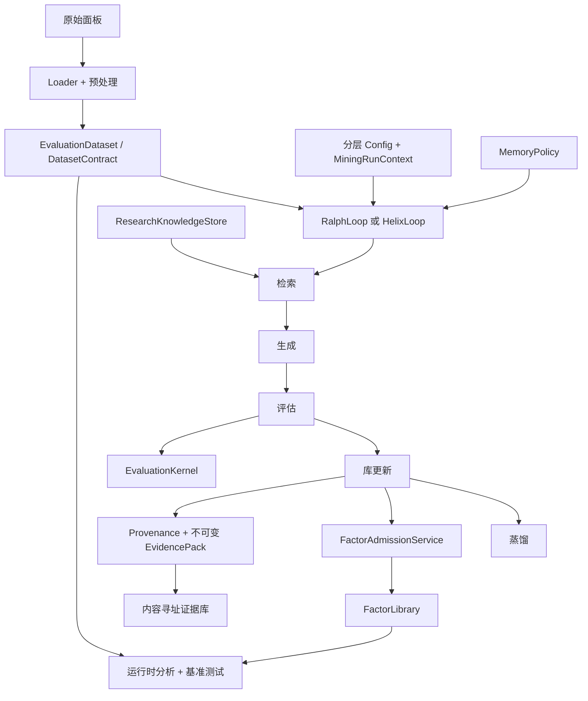

# FactorMiner 库中文详解

> 本文是对 `e:\py\factorminer\` 仓库(版本 0.1.0)的**深度阅读笔记**。
> 在保留 README 原文骨架的基础上,补充了对每个模块的设计动机、内部机制、关键算法与工程权衡的详细说明,
> 适合作为该库的**架构入门 + 二次开发参考**。
>
> 上游仓库:https://github.com/minihellboy/factorminer
> 论文: *FactorMiner: A Self-Evolving Agent with Skills and Experience Memory for Financial Alpha Discovery* (arXiv:2602.14670)

### 文档定位与文档族谱

| 来源 | 数量 | 路径 |
| --- | --- | --- |
| 上游 docs/ 英文文档 | **7 份** | `e:\py\factorminer\docs/` |
| 上游 README + CONTRIBUTING | 2 份 | `e:\py\factorminer\` |
| 上游关键模块源码 | 10 余个 | `e:\py\factorminer\factorminer/` |
| **本文档(本文)** | 1 份 | `e:\py\QuantFactor\docs\factorminer-中文文档.md` |
| **对照中文版** | **9 份** | 见下方"对照中文版清单" |

### 与 9 份对照中文版的章节映射

本文档是**重新组织过的深度阅读笔记**,不是逐文档翻译;对照翻译保留原文件结构,适合**逐文档对照**阅读。两套文档的章节映射如下:

| 上游文档 | 对照中文版 | 本文相关章节 |
| --- | --- | --- |
| README.md | `e:\py\factorminer\README-中文.md` | 第 1/2/3/4 章(库定位/特性/安装/快速上手) |
| CONTRIBUTING.md | `e:\py\factorminer\CONTRIBUTING-中文.md` | 第 13.2 节(依赖方向)、第 16 章(开发与测试) |
| architecture.md | `e:\py\factorminer\docs\architecture-中文.md` | 第 5/6/13 章(架构与模块归属) |
| reproducibility.md | `e:\py\factorminer\docs\reproducibility-中文.md` | 第 12 章(基准测试与可复现性) |
| evidence-protocol.md | `e:\py\factorminer\docs\evidence-protocol-中文.md` | 第 7 章(证据协议) |
| security.md | `e:\py\factorminer\docs\security-中文.md` | 第 8 章(安全模型) |
| hosted-pilot.md | `e:\py\factorminer\docs\hosted-pilot-中文.md` | 第 14.1 节(Hosted Pilot) |
| public-evidence-release.md | `e:\py\factorminer\docs\public-evidence-release-中文.md` | 第 14.2 节(Public Evidence Release) |
| design-partner-pilot.md | `e:\py\factorminer\docs\design-partner-pilot-中文.md` | 第 14.3 节(Design-Partner Pilot) |

> 阅读建议:**先读本文档**(架构图 + 设计动机 + 模块关联),再**对照阅读中文版**(原文骨架 + 命令示例),最后**回到上游英文版**核对术语。

---

## 目录

1. [库的本质与定位](#1-库的本质与定位)
2. [核心特性一览](#2-核心特性一览)
3. [安装与环境](#3-安装与环境)
4. [快速上手](#4-快速上手)
5. [整体架构与设计哲学](#5-整体架构与设计哲学)
6. [核心模块深度解读](#6-核心模块深度解读)
   - [6.1 类型化公式 DSL](#61-类型化公式-dsl)
   - [6.2 算子注册表与多后端执行](#62-算子注册表与多后端执行)
   - [6.3 Ralph Loop —— 论文规范的生成/评估/进化循环](#63-ralph-loop--论文规范的生成评估进化循环)
   - [6.4 Helix Loop —— 扩展研究通道](#64-helix-loop--扩展研究通道)
   - [6.5 经验记忆系统](#65-经验记忆系统)
   - [6.6 多阶段评估流水线](#66-多阶段评估流水线)
   - [6.7 因子库与准入/替换机制](#67-因子库与准入替换机制)
   - [6.8 LLM 智能体与多 Agent 辩论](#68-llm-智能体与多-agent-辩论)
7. [证据协议:从 IC 到 PBO 的完整链路](#7-证据协议从-ic-到-pbo-的完整链路)
8. [安全模型与信任边界](#8-安全模型与信任边界)
9. [MCP 智能体网关与集成](#9-mcp-智能体网关与集成)
10. [数据契约与连接器](#10-数据契约与连接器)
11. [命令行工具](#11-命令行工具)
12. [基准测试与可复现性](#12-基准测试与可复现性)
13. [仓库布局与依赖方向](#13-仓库布局与依赖方向)
14. [Pilot 三件套与公开证据发布(补充章节)](#14-pilot-三件套与公开证据发布补充章节)
    - [14.1 Hosted Pilot:托管研究的运维与控制](#141-hosted-pilot托管研究的运维与控制)
    - [14.2 Public Evidence Release:可独立验证的公开证据 Runbook](#142-public-evidence-release可独立验证的公开证据-runbook)
    - [14.3 Design-Partner Pilot:私有数据集的有界审阅](#143-design-partner-pilot私有数据集的有界审阅)
15. [文档索引](#15-文档索引)
16. [开发与测试](#16-开发与测试)
17. [许可](#17-许可)

---

## 1. 库的本质与定位

FactorMiner 不是交易系统,**它是一个受治理的研究引擎**,专用于:

- **发现**可解释的 alpha 因子(用类型化 DSL 表达,而不是任意 Python 代码);
- **评估**这些因子的预测能力(包含 IC、RankIC、ICIR、显著性、容量、成本等多维度);
- **持久化**所有结果(因子库、记忆、证据、报告),供人工审查。

它在三类边界上**严格自律**:

| 边界 | 库的态度 |
| --- | --- |
| 推荐交易 | **不**做任何交易/仓位/风险限额/订单路由 |
| LLM 输出的可信度 | **不信任**任何 LLM 文本;只信任 DSL 解析后的表达式树与运行时重算 |
| 第三方基线 | 110 个内置因子是**忠实复现**;命名的 Alpha101/GPLearn/AlphaForge/AlphaAgent 等基线**仅作为代理/目录近似**,在 manifest 中显式标注 |

这一定位使它成为**研究基础设施**,而非"开箱即用的 alpha 信号源"。

---

## 2. 核心特性一览

| 能力 | 实现要点 |
| --- | --- |
| 类型化 DSL + 算子注册表 | LLM 输出**只**能生成 DSL 字符串;解析 → 表达式树 → 类型校验 → 注册算子执行;无法注入任意 Python |
| **Ralph Loop** | 论文规范的"检索 → 生成 → 评估 → 更新 → 蒸馏"循环 |
| **Helix Loop** | 在 Ralph 基础上,可选加入 KG/嵌入混合检索、多 Agent 辩论、SymPy 规范化、因果/制度/容量/显著性验证、在线遗忘 |
| **基于策略的记忆** | 6 种 `MemoryPolicy`:paper / none / kg / family_aware / regime_aware / edit_aware |
| **运行时重算** | 任何分析/基准测试都**重新解析+执行** DSL,**不**信任保存的分值 |
| **基准测试运行时** | 冻结 Top-K、记忆/策略消融、CPCV/PBO、成本压力、算子/因子效率 |
| **研究知识库** | 内容寻址的来源决策 + 假设 + 结果归因;LLM 检索时只看到结构化 archetype,不直接看原文 |
| **证据包** | SHA-256 内容寻址、不可变、含数据/配置/代码哈希;`verify-evidence` 可校验完整性 |
| **研究扩展** | EDGAR / 期货连续合约 / 拥挤度 / 容量 / 敏感性 / 模型风险 / provenance |
| **MCP 智能体网关** | 本地 stdio + 可选鉴权 HTTP;`factor-researcher` 提供 plugin 和 managed-agent 两种集成形态 |

---

## 3. 安装与环境

### 3.1 推荐:uv(开发全量)

```bash
git clone https://github.com/minihellboy/factorminer.git
cd factorminer
uv sync --group dev --all-extras
```

### 3.2 精简环境

```bash
uv sync --group dev
uv sync --group dev --extra llm   # 仅添加 LLM 提供商(openai/anthropic/google-generativeai)
uv sync --group dev --extra mcp   # 仅添加 MCP 服务器
```

### 3.3 可选 extras 速查

| extra | 用途 |
| --- | --- |
| `llm` | OpenAI / Anthropic / Google Generative AI 客户端 |
| `embeddings` | sentence-transformers + faiss-cpu(用于 KG/嵌入检索) |
| `mcp` | `mcp>=1.27,<2`,MCP 服务器 |
| `research` | networkx(知识图谱)+ statsmodels + sympy(规范化) |
| `ml` | torch + xgboost(模型风险评估) |
| `visualization` | matplotlib + seaborn + tabulate |
| `gpu` | torch + `cupy-cuda12x`(仅 Linux) |

### 3.4 pip 替代

```bash
python3 -m pip install -e ".[llm,mcp]"
```

### 3.5 执行后端

| 后端 | 触发条件 | 备注 |
| --- | --- | --- |
| NumPy | 默认,所有平台 | 可移植性最佳 |
| C 后端 | 装好 `bottleneck` | 部分算子自动加速 |
| PyTorch / CUDA | 装好 `torch`,Linux 下装 `cupy-cuda12x` | 用 `--gpu` 启用 |

> 工程权衡:**默认 NumPy + Bottleneck** 而非 GPU,是为了**可复现性**:任何人重跑都不需要 A100。
> 论文的硬件级速度表不属于"代码可复现"的范畴,见 `docs/reproducibility.md`。

---

## 4. 快速上手

### 4.1 零 API Key 演示

```bash
uv run python scripts/run_demo.py        # 一站式 demo
uv run factorminer quickstart            # 健康检查 + 小型 mock 库
uv run factorminer doctor --json         # 环境自检
```

`quickstart` 会在 `/tmp/factorminer-quickstart/` 下写出**小型因子库 + 静态报告**。

> 警告:`mock` 模式产出的分值**只证明执行路径通顺,不代表任何市场表现**。

### 4.2 直接挖掘

```bash
# mock 模式,生成 2 批 × 每批 8 个候选,迭代 10 次
uv run factorminer -o /tmp/factorminer-run mine --mock -n 2 -b 8 -t 10

# 查看会话内部状态
uv run factorminer session inspect /tmp/factorminer-run --telemetry
```

### 4.3 真实数据(必须先校验 schema)

```bash
uv run factorminer validate-data path/to/market_data.csv
uv run factorminer -c factorminer.local.yaml -o output-real \
  mine --data path/to/market_data.csv
```

面板必需字段:

```text
datetime, asset_id, open, high, low, close, volume, amount
```

**别名接受**:`symbol` / `ticker` / `code` / `ts_code` 作为 `asset_id` 的别名;`amt` 作为 `amount` 的别名。
**自动推导**:`vwap = amount / volume`、`returns = pct_change(close)` 可由运行时层派生。

---

## 5. 整体架构与设计哲学

### 5.1 系统形态(架构图)



### 5.2 五大设计原则

1. **保存的分值只是元数据,真相在重算里** —— 任何分析/基准都重新解析+执行 DSL;
2. **数据、配置、代码与证据一起哈希** —— `EvidencePack` 是 SHA-256 内容寻址的;
3. **Ralph 与 Helix 共用同一套**生成器、解析器、阶段契约、准入服务、策略持久化;Helix 仅替换"命名阶段实现"与"可选验证服务";
4. **依赖方向是"自下而上"的**:`domain` 不 import 任何上层;`application` 不 import CLI/MCP;
5. **架构层只持有契约,循环层只做编排** —— 防止"主循环变瑞士军刀"。

### 5.3 关键分层

| 层 | 包 | 它拥有 | 它**不**拥有 |
| --- | --- | --- | --- |
| `domain` | `factorminer/domain/` | 无依赖的数值契约 | 编排、适配器、接口 |
| `application` | `factorminer/application/` | 类型化执行上下文 + 跨工作流契约 | CLI 解析、数值语义 |
| `architecture` | `factorminer/architecture/` | 协议、策略、阶段、可复用服务 | CLI、提供商特定 UI |
| `core` | `factorminer/core/` | 循环编排、DSL/解析器、表达式、库、I/O | 并行基准、策略实现 |
| `agent` | `factorminer/agent/` | 模型提供商、prompt、生成、辩论 | 指标/准入真相 |
| `data` | `factorminer/data/` | 摄取、规范化、连接器、张量构建 | 研究决策 |
| `evaluation` | `factorminer/evaluation/` | 重算、指标、诊断、报告 | 循环编排 |
| `benchmark` | `factorminer/benchmark/` | 对比契约、数据集、运行器、统计、报告 | 平行的循环基础设施 |
| `memory` | `factorminer/memory/` | 存储、检索原语、嵌入 | 循环特定持久化策略 |
| `operators` | `factorminer/operators/` | 类型化算子规格 + 多后端执行 | 数据获取 |
| `mcp` | `factorminer/mcp/` | 窄而精的外部工具/资源接口 | 核心研究逻辑 |

依赖方向由 `scripts/check_architecture.py` 在 CI 中强制。

---

## 6. 核心模块深度解读

### 6.1 类型化公式 DSL

#### 6.1.1 语法概览

DSL 是类似公式语言的字符串:

```text
Neg(CsRank(Div(Sub($close, $vwap), $vwap)))
```

形式化语法(`factorminer/core/parser.py`):

```text
expression     := function_call | feature_ref | number
function_call  := IDENTIFIER '(' arg_list ')'
arg_list       := expression (',' expression)*
feature_ref    := '$' IDENTIFIER
number         := ['-'] DIGITS ['.' DIGITS] [('e'|'E') ['-'|'+'] DIGITS]
```

#### 6.1.2 标准特征叶(可在所有公式里用)

| 叶 | 含义 |
| --- | --- |
| `$open` `$high` `$low` `$close` | 标准 OHLC |
| `$volume` `$amt` | 量与成交额 |
| `$vwap` `$returns` | 派生量,缺失时由运行时层推导 |

通过特征注册表可加入**作用域受限的叶**(如点-in-time EDGAR 基本面、期货连续合约属性),但**默认只接受标准 OHLCV**。

#### 6.1.3 解析器实现要点

- `parser.py` 是手写**递归下降解析器**,tokenizer 用正则;
- 输出是 `ExpressionTree`,节点类型:
  - `LeafNode` —— 特征引用
  - `OperatorNode` —— 函数调用
  - `ConstantNode` —— 字面量
- 解析失败 = 显式 `SyntaxError`,**绝不静默**;
- 后续由 `OPERATOR_REGISTRY` 做算子规格校验(arity、类型),不通过的算子直接拒绝。

#### 6.1.4 为什么用 DSL 而不是"LLM 生成 Python"?

| 风险 | DSL 如何规避 |
| --- | --- |
| 任意代码执行 | DSL 是闭语法;LLM 输出**永远不能**等价于 `eval`/`exec` |
| 类型不一致 | 每个算子有 arity/输入类型规格 |
| 输出不可解释 | 表达式树本身就是 AST,可可视化、可遍历 |
| 算子爆炸 | 注册表是单点管控,加新算子必须改 spec |

---

### 6.2 算子注册表与多后端执行

#### 6.2.1 三层结构

`factorminer/operators/registry.py` 把所有算子归并为一张表:

```python
OPERATOR_REGISTRY: dict[str, tuple[OperatorSpec, np_fn, torch_fn]]
```

每条记录是 `(规格, NumPy 实现, Torch 实现)`,规格来自 `core/types.py`,实现来自分类模块:

| 模块 | 算子类别 |
| --- | --- |
| `arithmetic.py` | 算术:Add/Sub/Mul/Div/Neg/Abs/Sign/Sqrt/Log/Pow … |
| `logical.py` | 逻辑:And/Or/Not/If … |
| `statistical.py` | 统计:Mean/Std/Skew/Kurt/Mad/Zscore … |
| `timeseries.py` | 时序:Delay/Diff/TsRank/Decay/Sma/Ema … |
| `crosssectional.py` | 截面:CsRank/CsZscore/CsIndNeutralize/CsScale … |
| `smoothing.py` | 平滑:Sma/Ema/Wma/Hma … |
| `regression.py` | 回归:Regression/Slope/Resi … |

#### 6.2.2 后端选择

```python
get_impl(name, backend="numpy")  # "numpy" | "torch" | "c"
```

- **NumPy 后端**默认,跨平台;
- **C 后端**(`c_backend.py`)利用 `bottleneck` 加速部分滚动算子;
- **GPU 后端**(`gpu_backend.py`)在装好 CUDA 时启用,把信号计算搬到 GPU 张量上。

#### 6.2.3 自定义算子(沙箱)

`operators/custom.py` 提供受控的自定义算子入口:

- 通过 `sandbox.py` 限制语法与资源;
- 不允许 `eval`/`exec` LLM 输出;
- 自定义算子仍要走**类型化规格**,不能绕过。

#### 6.2.4 神经符号算子

`operators/neuro_symbolic.py` 提供"小型可训练模块嵌入到符号表达式"的桥接,例如:

- 用 PyTorch 训练一个**有界结构**的小网络;
- 把它的输出作为叶子插回符号表达式;
- **约束**了可训练参数的边界,避免黑盒化整条因子。

---

### 6.3 Ralph Loop —— 论文规范的生成/评估/进化循环

#### 6.3.1 一句话总结

> **检索 → 生成 → 多阶段评估 → 库更新 → 记忆蒸馏** 五步循环,直到库达到目标大小 K 或迭代耗尽。

#### 6.3.2 阶段拆解

```
┌──────────────────────────────────────────────────────────────────┐
│  R(M, L)  检索:从经验记忆中取先验                                  │
│      ↓                                                          │
│  G(m, L)  生成:LLM 输出 N 个候选 DSL 公式                         │
│      ↓                                                          │
│  E(α, D)  评估:四阶段流水线(详见 6.6)                             │
│      ↓                                                          │
│  L ← L + α   更新:仅在 IC ≥ τ_IC 且 max|ρ|<θ 时准入;否则替换检查  │
│      ↓                                                          │
│  E(M, F)   蒸馏:成功/失败模式反馈回记忆                            │
└──────────────────────────────────────────────────────────────────┘
```

#### 6.3.3 关键算法细节

- **多进程评估**:`evaluation/pipeline.py` 用 `ProcessPoolExecutor` 并行跑候选;
- **早停**:任何阶段失败立即淘汰,不浪费算力;
- **预算跟踪**:`application/mining_budget.BudgetTracker` 限制 LLM 调用次数、CPU 时长、候选数量;
- **检查点**:每批结束自动序列化库、记忆、运行 manifest,允许中断恢复。

#### 6.3.4 论文版本 vs 仓库版本的差异

| 维度 | 论文 | 仓库实现 |
| --- | --- | --- |
| 数据集 | A 股面板 + 64 资产 Binance 10m | 用户自备,**不**随仓 |
| 硬件 | A100 速度表 | CPU 默认,GPU 可选,本地跑分仅反映本机 |
| 全部基线 | Alpha101/GPLearn/AlphaForge/AlphaAgent 等忠实复现 | **部分目录代理**,manifest 显式标注 |

---

### 6.4 Helix Loop —— 扩展研究通道

#### 6.4.1 与 Ralph 的关系

`HelixLoop(RalphLoop)` —— **继承而非重写**。所有 Ralph 的能力都是 Helix 的子集,关闭所有 Phase 2 开关时,Helix 与 Ralph **行为完全一致**。

#### 6.4.2 五阶段扩展

```
1. RETRIEVE     — KG + embeddings + 扁平记忆混合检索
2. PROPOSE      — 多 Agent 辩论(specialists + critic)或标准生成
3. SYNTHESIZE   — SymPy 规范化,消除代数同构
4. VALIDATE     — 标准流水线 + 因果 + 制度 + 容量 + 显著性
5. DISTILL      — 标准记忆演化 + KG 更新 + 在线遗忘
```

#### 6.4.3 关键 Phase 2 组件

| 组件 | 作用 |
| --- | --- |
| `KnowledgeGraphService` | 因子/算子/家族构成图;支持图谱推理与多跳检索 |
| `OnlineForgettingService` | 衰减过时/低收益模式,避免记忆膨胀 |
| `Phase2ComponentFactory` | 工厂模式**可选**挂载,默认全部关闭 |
| `RegimeAwareMemoryPolicy` | 在不同市场制度(趋势/震荡/高波动)下采用不同记忆策略 |
| `FamilyAwareMemoryPolicy` | 按因子家族(动量/波动率/流动性/价量)分别引导 |
| `EditAwareMemoryPolicy` | 跟踪父→子 AST 编辑,给出"基因型信用"与"veto" |

#### 6.4.4 工程取舍

> **为什么 Helix 不创建并行的基准/记忆基础设施?**
> Ralph/Helix 共用同一套评估内核、同一份库、同一份证据结构。
> 唯一差异是"在哪个阶段插入哪个可选组件"。
> 这样,基准测试结果在两条 lane 间具有**直接可比性**。

---

### 6.5 经验记忆系统

#### 6.5.1 数据结构

```python
@dataclass
class ExperienceMemory:
    state: MiningState              # S: 库的全局状态快照
    success_patterns: list[SuccessPattern]   # P_succ: 推荐方向
    forbidden_directions: list[ForbiddenDirection]  # P_fail: 禁忌方向
    insights: list[StrategicInsight]        # I: 战略级经验
```

#### 6.5.2 六种 `MemoryPolicy`

| 策略 | 行为 | 适用场景 |
| --- | --- | --- |
| `paper` | 论文风格的扁平成功/失败/insight | 复现论文 |
| `none` | **消融**用,完全无记忆 | 基准对照 |
| `kg` | 知识图谱 + 词法/稠密混合检索 | 大库、多家族 |
| `family_aware` | 引导向**家族缺口**走,远离**饱和家族** | 多样性最大化 |
| `regime_aware` | 根据市场制度切换上下文 | 跨制度数据 |
| `edit_aware` | AST 编辑父子信用 + veto | 抑制"近亲繁殖" |

#### 6.5.3 检索与持久化

- `retrieval.py`:基础检索接口;
- `kg_retrieval.py` + `knowledge_graph.py`:图谱多跳;
- `embeddings.py`:句子嵌入 + Faiss 索引;
- `formation.py` / `evolution.py`:模式形成与演化规则;
- `online_regime_memory.py`:在线制度检测与记忆分支。

每个策略**自带序列化与恢复**方法,中断后可重启。

#### 6.5.4 编辑感知记忆(进阶)

> 当一个因子 α 由父因子 α_parent 经过某个 AST 编辑 e 产生时,
> `edit_aware` 会把 e 的成功率归因于 α_parent —— 形成"基因型信用"。
> 如果某条编辑 e 反复产出低 IC 后代,它会被**永久 veto**。

---

### 6.6 多阶段评估流水线

#### 6.6.1 四阶段(算法 1 Step 3)

| Stage | 内容 | 资源消耗 |
| --- | --- | --- |
| 1. Fast IC | 在快速子集 `M_fast` 上计算 RankIC | 低 |
| 2. 库相关性 | 与现存库 L 计算最大 `|ρ|` | 低 |
| 2.5 替换检查 | 强候选尝试**替换**已有高相关因子 | 中 |
| 3. 批内去重 | 候选两两 `|ρ| < θ` | 中 |
| 4. 全验证 | 完整 `M_full` 上的全套指标 + 轨迹 | 高 |

#### 6.6.2 准入/替换规则

```text
准入:    IC(α) ≥ τ_IC   AND   max_{g∈L} |ρ(α, g)| < θ
替换:    IC(α) ≥ 0.10   AND   IC(α) ≥ 1.3 · IC(g)   AND   仅 1 个相关因子
```

#### 6.6.3 评估内核的关键指标

| 指标 | 定义 | 用途 |
| --- | --- | --- |
| `ic_mean` | `mean(IC_t)` | 符号化诊断 |
| `ic_paper_mean` | `abs(mean(IC_t))` | **论文模式**准入与替换 |
| `ic_abs_mean` | `mean(abs(IC_t))` | **遗留**诊断(不推荐) |
| `icir` | `mean / std` | 符号 ICIR |
| `ic_paper_icir` | `abs(mean) / std` | 论文模式 ICIR 门槛 |
| `rank_ic_*` / `pearson_ic_*` | 新版显式字段 | 区分线/秩相关 |
| `turnover` | 单边换手率 | 经济性 |
| `cost_curve` | 5/10/20 bps 净收益 | 摩擦成本 |

#### 6.6.4 诊断子包

| 模块 | 内容 |
| --- | --- |
| `significance.py` | 显著性(FDR/Block-bootstrap/HAC) |
| `cross_validation.py` | CPCV(组合 purged cross-validation) |
| `causal.py` | 因果检验(Granger 等) |
| `decay.py` | IC 衰减曲线 |
| `regime.py` | 不同制度下的稳定性 |
| `capacity.py` | 容量上限 + 平方根冲击模型 |
| `transaction_costs.py` | 显式换手+成本曲线 |
| `crowding.py` | 拥挤度 |
| `portfolio.py` | 多空组合构造 |
| `combination.py` | 多因子组合(Lasso 等) |
| `formula_sensitivity.py` | 公式扰动稳健性 |
| `model_zoo.py` | 模型风险评估 |
| `mrm_pack.py` | Model Risk Management 证据包 |

> 重要约束:这些诊断**默认不参与准入**;它们是 opt-in 研究扩展,
> 用于更严格的证据审查,**不会**悄然改变论文模式的准入门槛。

---

### 6.7 因子库与准入/替换机制

#### 6.7.1 库的数据结构

```python
@dataclass
class Factor:
    id: int
    name: str
    formula: str
    category: str                # 家族分类
    ic_mean, icir, ic_win_rate: float
    max_correlation: float       # 准入时与库最大 |ρ|
    batch_number: int
    ic_paper_mean, ic_abs_mean, ic_paper_icir: float
    metric_version: str = "paper_ic_v2"
    signals: np.ndarray | None   # (M, T) 重算信号
    research_metrics: dict
    provenance: dict
    evidence_ids: tuple[str, ...]
```

#### 6.7.2 库管理器

`factor_library.FactorLibrary`:

- 维护 `dict[id, Factor]`;
- 暴露 `add(factor) → bool` / `replace(old_id, new) → bool` / `find_correlated(...)`;
- 与 `FactorAdmissionService`(架构层)**强绑定**;
- `provenance.py` 记录每个因子的 `parent_lineage`(父因子链)。

#### 6.7.3 唯一变更入口

> 任何对库的修改必须经过 `FactorAdmissionService`。
> 跨岛(multi-island)迁入因子也走同一入口。
> 这样,准入/替换不变量保持在**单一职责**的服务里。

---

### 6.8 LLM 智能体与多 Agent 辩论

#### 6.8.1 提供商抽象

`factorminer/agent/llm_interface.py` 定义了统一接口 `LLMProvider`:

| 提供商 | 特性 |
| --- | --- |
| `OpenAIProvider` / `AnthropicProvider` / `GeminiProvider` | 官方远程 |
| `OpenAICompatibleProvider` | 用户自配 `base_url`(本地 vLLM/Ollama 等) |
| `MockProvider` | 离线演示 |
| `CascadeProvider` | **draft→frontier 级联**:便宜模型起草,贵模型修错 |
| `PrefixedCacheProvider` | 共享字节稳定前缀,命中 prompt cache |

#### 6.8.2 级联是 FactorMiner 的差异化优势

论文提到:**级联**路由信号来自 FactorMiner 自有的 DSL 解析器 —— 解析失败 = 升级。
这比"通用的 agentic cost"论文里"看 token 数"或"看置信度"更精确。

#### 6.8.3 `FactorGenerator` 主类

- 调用 LLM、构造 prompt、解析输出为 `CandidateFactor`;
- 处理重试、修复(repair path 强制升级到 frontier);
- 暴露 `cacheable_prefix` 让并行调用共享 prompt cache breakpoint。

#### 6.8.4 多 Agent 辩论(FactorMAD)

`agent/debate.py`:

- `DebateGenerator` 是 `FactorGenerator` 的**drop-in 替代**;
- 多个领域专家(momentum / volatility / liquidity / regime)**并行**生成;
- `CriticAgent` 多维打分预筛;
- 可选 `DebateMemory` 跟踪历史 + 盲点检测;
- `PrefixedCacheProvider` 让专家们共享同一 cache prefix,**降低 token 成本**;
- 可选 `FormulaCanonicalizer`(SymPy)消除代数同构。

#### 6.8.5 输出解析与容错

`agent/output_parser.py`:

- 期望 LLM 输出**结构化对**(公式 + 经济解释);
- 解析失败 → repair → frontier;
- 多次失败 → 标记 rejected,**绝不**用保存分值蒙混过关。

---

## 7. 证据协议:从 IC 到 PBO 的完整链路

### 7.1 信任层级

| 层 | 它回答什么 | 最低可信证据 | FactorMiner 状态 |
| --- | --- | --- | --- |
| **数据完整性** | 信息在决策点是否可得? | 点-in-time 字段、退市、公司行动、源哈希 | 调用方契约 + manifest |
| **预测关联** | 信号是否序贯/线性预测未来收益? | Pearson IC + Spearman RankIC(分时期、覆盖率、符号) | **同时报告** |
| **采样不确定性** | 均值在序列依赖下是否稳定? | IC 序列 + Newey-West/HAC t-stat + 块自助 CI | 已实现 |
| **选择卫生** | 赢家是否从多次试验中选出? | 试验总数 + 家族 p 值 + FDR + DSR + CPCV 路径矩阵/PBO | 完整输入时实现 |
| **时间泛化** | 拟合是否在持仓评估的上游? | 训练/验证/测试冻结、purge label overlap、滚动制度 | 已实现 |
| **风险归因** | 信号是不是换皮的风险敞口? | 点-in-time 风格/行业敞口 + 残差指标 | OLS/WLS 残差化已实现 |
| **经济实施** | 在摩擦下是否存活? | 目标权重换手 + 成本曲线 + 价差/费用/冲击 + 容量 | 线性成本 + 容量模块 |
| **独立回放** | 另一执行引擎能否复现订单/PnL? | 冻结权重/订单 + 日历 + 撮合 | **未捆绑**,推荐 LEAN |
| **前向真值** | 行为在研究结束后是否延续? | 论文/实盘 track record | 外部 |

### 7.2 IC / RankIC 的"命名陷阱"

> RankIC = Spearman 截面相关系数;
> PearsonIC = Pearson 截面相关系数;
> `ic_series` 历史命名 = RankIC。

| 字段 | 定义 | 用途 |
| --- | --- | --- |
| `ic_mean` | `mean(IC_t)` | 符号化诊断 |
| `ic_paper_mean` | `abs(mean(IC_t))` | 论文准入与替换 |
| `ic_abs_mean` | `mean(abs(IC_t))` | **遗留**,不稳定 |
| `icir` | `mean / std` | 符号 ICIR |
| `ic_paper_icir` | `abs(mean) / std` | 论文 ICIR 门槛 |
| `pearson_ic_*` / `rank_ic_*` | 新版显式字段 | 双口径报告 |

#### 例:为什么 `ic_abs_mean` 是陷阱?

`IC = [0.1, -0.1]`:`ic_abs_mean = 0.1`(听起来很大),`ic_paper_mean = 0.0`(无方向,论文模式拒绝)。
论文模式用**后者**,系列有"幅值"但**没有稳定方向**不能算 alpha。

### 7.3 ICIR 与 t 统计(四种不可混用)

```
ICIR             = mean(IC_t) / sample_std(IC_t)
annualized ICIR  = ICIR × √(periods_per_year)
independence t   = ICIR × √(N)              # 正序列相关时过度乐观
HAC t            = mean(IC_t) / NeweyWestSE  # 主推
```

> **不要按字段名盲比**:
> AlphaBench 的 `FL_Icir = √n·mean/std` 是独立性 t 统计,
> 不是 FactorMiner 的非年化 ICIR。

### 7.4 多重检验控制

- **Family-wide Benjamini-Hochberg FDR**:族内假发现率;
- **Block-bootstrap IC CI**:块自助的秩 IC 置信区间;
- **Deflated Sharpe(DSR)**:考虑试验数与非正态矩;
- **PBO**:CPCV 路径矩阵上的过拟合概率。

四种手段**互补**,不互替。详见 `docs/evidence-protocol.md`。

### 7.5 风险模型残差化

```
signal_t = intercept + exposure_t·β_t + residual_signal_t
```

- 接受静态或点-in-time 数值敞口 + one-hot 分类 + 可选 WLS;
- 残差信号上**重做**全部指标与换手/成本曲线;
- **不**等同于 MSCI Barra 的完整模型(因子收益/协方差/特异风险)。

### 7.6 公开 API(Industry Evidence)

```python
from factorminer.evaluation import (
    IndustryEvidenceConfig,
    evaluate_industry_evidence,
)

report = evaluate_industry_evidence(
    "candidate_042",
    signals, forward_returns,
    config=IndustryEvidenceConfig(
        periods_per_year=252,
        cost_bps=(0, 5, 10, 20),
        primary_cost_bps=10,
    ),
    risk_exposures=style_and_industry_exposures,
    risk_weights=float_market_cap,
    exposure_names=["size", "beta", "momentum", "industry_software"],
    family_ic_series=every_tried_factor_rankic,
    n_trials=total_search_trials,
    pbo_performance_matrix=trial_by_cpcv_path_scores,
    volume=point_in_time_dollar_volume,
)
payload = report.to_dict()
```

输出字段:`pearson_ic_*`、`rank_ic_*`、`icir`、`hac_t`、`fdr_q`、`dsr`、`pbo`、`turnover_*`、`cost_*`、`capacity_*`、`warnings`。

---

## 8. 安全模型与信任边界

### 8.1 受保护资产

- 提供商凭证、MCP bearer token、授权市场数据;
- 选定输入/输出路径**之外**的本地文件;
- 研究产物本身;
- 评估结果的完整性。

### 8.2 不可信输入

- CSV / Parquet / HDF / Qlib / 连接器返回;
- 保存的因子库与会话产物;
- **所有** LLM 输出、公式、研究笔记;
- MCP 工具参数、远程 HTTP 响应、本地 OpenAI-兼容端点。

### 8.3 显式边界

```
[不可信输入] → [Schema/parser 验证] → [FactorMiner 引擎] → [转义后结构化产物]
[智能体宿主] → [MCP 边界] → [引擎]
[环境密钥] → [MCP / 显式出站连接器]
```

### 8.4 文件系统与子进程

- MCP 引擎工具用**显式 argv 数组**调用 CLI,**不**用 `shell=True`;
- 输出限定在 `./out/`,仅 `librarian` 叶具有写权限;
- `output/` 被 Git 忽略;
- 数据加载器**不**执行文件内容。

### 8.5 出站连接器(全部显式)

| 表面 | 数据 | 触发命令 |
| --- | --- | --- |
| `data/edgar_source.py` | SEC EDGAR XBRL facts | `attach-edgar` |
| `data/mcp_source.py` | 已配置外部 MCP 表数据 | `fetch-data` |
| `evaluation/crowding.py` | 公开共识因子收益面板 | 显式 crowding 工作流 |
| `data/futures_source.py` | 连续期货输入变换 | `build-futures` |

EDGAR 固定 `https://data.sec.gov`、限制响应大小、发送描述性 UA、限速到 SEC 公平时窗;
共识因子抓取**拒绝非 HTTPS**,强制响应大小上限;
`MCPDataSourceConfig` 操作员控制 YAML,`${ENV}` 展开避免凭证落盘;
普通 `mine` / `helix` **不**触发无人值守出站抓取。

### 8.6 MCP 服务器

#### Stdio(默认)

```bash
uv run factorminer mcp-serve --transport stdio
```

- 本地子进程管道,**无**网络监听,**无**应用层鉴权;
- 边界就是进程启动器与宿主机用户账户。

#### HTTP(可选)

```bash
export FACTORMINER_MCP_TOKEN="$(openssl rand -hex 32)"
uv run factorminer mcp-serve \
  --transport http --host 127.0.0.1 --port 8765
```

- 默认绑 `127.0.0.1`,启动**强制**检查 token 非空;
- 客户端必须 `Authorization: Bearer <token>`;
- 用 MCP SDK 的 `StaticBearerTokenVerifier`;
- **没有**未鉴权 HTTP 模式;
- 静态 bearer token 是单操作员/可信网络控制,**不**提供用户身份/角色/租户隔离/每工具授权。

### 8.7 本地/前沿模型级联

- 自配 `base_url` **不能**来自公式 / LLM 输出 / 研究笔记 / MCP 请求;
- 缺失自配 `base_url` → **错误**(不是回退);
- 自配 provider **不**回退到 `OPENAI_API_KEY`;
- 前沿 provider 构造时**剥除**自配 `base_url`;
- 启用自配端点 = 信任它访问 draft 路径的全部 prompt。

### 8.8 公式与生成代码边界

- 默认因子表面是**类型化 DSL**,不是任意 Python;
- LLM 文本**永不**进入 `eval` / `exec`;
- 自定义算子沙箱必须保留同样资源/语法限制;
- 解析失败的公式**绝不**用保存分值替代。

### 8.9 Prompt 与记忆注入

- 研究笔记 / 模型输出**只**通过结构化边界再次进入 prompt:
  - `ResearchArchetype` 字段(而不是原始文档);
  - `PromptContextBuilder` 渲染类型化摘要;
  - Sealed 评估反馈**白名单**粗粒度字段;
  - 经济解释随因子附加,但**不是**系统指令;
- 失真评估响应 → 中性/rejected。

### 8.10 HTML 与报告渲染

- 公式名/解释/narrative/model-authored 文本 → `html.escape`;
- 经济解释**未人工认证**前一律标 `UNATTESTED -- LLM DRAFT, NOT REVIEWED`;
- 静态报告**不**执行嵌入的模型输出;
- 回归测试含字面 `<script>` 载荷并断言转义。

### 8.11 评估完整性

- 运行时分析**重算**所选数据集上的公式;
- 训练/测试边界显式且共享;
- 基本面点-in-time 用可用日期 join;
- 代理/部分基线**在 manifest 中标注**;
- Sealed 多评估器模式**只**对外暴露"一致性摘要",不暴露评分细节;
- 缺失诊断 = 缺失,默认**不**填"安全"值。

### 8.12 密钥与持久化

- API key / bearer token **只**在环境变量或批准的密钥库;
- 永不入 Git YAML、永常在日志、报告、会话状态、RFT、基准 manifest;
- 当前持久化表面**不存**提供商密钥;
- RFT 导出 `trains_model: false`(只产数据集,不动模型训练)。

### 8.13 模型序列化

- 仓库**不**调用 `torch.load` 外部 checkpoint;
- Python pickle 检查点执行面在当前运行时**不存在**;
- 外部序列化模型对象**不接受**为 CLI/MCP 输入。

---

## 9. MCP 智能体网关与集成

### 9.1 集成的两种形态

| 形态 | 路径 | 适用 |
| --- | --- | --- |
| **plugin** | `integrations/factor-researcher/plugin/` | Claude Code / Cowork plugin,可装可卸 |
| **managed-agent** | `integrations/factor-researcher/managed-agent/` | 无头编排 + 类型化叶 agent 清单 |

二者复用同一份 `agents/factor-researcher.md` 系统提示与 `skills/`,**不**复制引擎逻辑。

### 9.2 MCP 工具清单

```
doctor                  validate_data           fetch_data
list_fsi_connectors     resample_data           mine_factors
helix_mine              ingest_research_note    evaluate_library
screen_factors          combine_factors         run_benchmark
generate_report         export_library          inspect_session
get_factor_library      inspect_debate
```

资源模板:`factorminer://docs/{topic}` 提供仓库 `docs/` 下任意 Markdown。

### 9.3 子 Agent 责任与权限

| 叶 | 责任 | 直写权限 |
| --- | --- | --- |
| `data-steward` | 校验或抓取不可信市场数据 | **否** |
| `miner` | 跑 Ralph / Helix 挖掘 | **否** |
| `evaluator` | 重算/评估/回测/基准 | **否** |
| `librarian` | 写最终库/报告到 `./out/` | **是**(唯一) |

每个叶声明 `output_schema`,host 应拒绝任何**未通过 schema 校验**的 handoff。

### 9.4 入站金融数据连接器

`factorminer/data/mcp_source.py` —— **反向路径**:MCP 客户端从外部 provider 拉数据,转 FactorMiner 的标准面板。

`MCPDataSourceConfig` 描述符(不是硬编码厂商分支):

```yaml
transport: http | stdio              # http 需 url,stdio 需 command+args
url: https://...
headers:
  X-API-Key: ${MY_KEY}
tool: get_ohlcv
arguments:
  symbol: BTC/USDT
records_path: result.records
field_mapping:
  ts: timestamp
  o: open
  h: high
  l: low
  c: close
  v: volume
columns_order: [ts, o, h, l, c, v]   # 可选,定位字段
constant_columns:
  asset_id: BTC/USDT                 # call 参数固定
datetime_unit: ms                    # 毫秒纪元
derive_amount_from_close_volume: false
```

`ccxt_binance.yaml` 示例展示了"按 symbol 单次调用,客户端组装多资产面板"的范式。

---

## 10. 数据契约与连接器

### 10.1 标准化长格式面板

```text
datetime, asset_id, open, high, low, close, volume, amount
```

### 10.2 接受别名

| 字段 | 别名 |
| --- | --- |
| `datetime` | `timestamp`, `date`, `time`, `trade_date` |
| `asset_id` | `ticker`, `symbol`, `code`, `stock_code`, `ts_code`, `instrument` |
| `amount` | `amt`, `turnover`, `value`, `traded_amount` |
| `close` | `close_price`, `price` |
| `open`/`high`/`low` | `*_price` |
| `volume` | `vol` |

### 10.3 运行时派生(可推导)

- `vwap = amount / volume`;
- `returns = pct_change(close)`(每资产)。

**派生值只是运行时变换,不要当作"vendor 观测字段"**。

### 10.4 内置样本数据

`data/binance_crypto_5m.csv`(20 资产 × 1000 行,5 分钟):

- 用途:schema 校验、CLI smoke、examples;
- **不**是论文基准数据集;
- manifest: `data/binance_crypto_5m.manifest.json`;
- 配置文件: `factorminer/configs/binance_sample.yaml`。

### 10.5 重采样

```bash
uv run factorminer resample-data \
  data/binance_crypto_5m.csv \
  /tmp/binance_crypto_10m.csv \
  --rule 10min
```

| 字段 | 聚合 |
| --- | --- |
| `open` | first |
| `high` | max |
| `low` | min |
| `close` | last |
| `volume`/`amount` | sum |
| `vwap` | 重算为 `amount/volume` |
| `returns` | 重算自重采样后的 close |

---

## 11. 命令行工具

### 11.1 命令清单(高频)

| 命令 | 作用 |
| --- | --- |
| `mine` | Ralph Loop 挖掘 |
| `helix` | Helix Loop 挖掘 |
| `evaluate` | 重算 + 评估保存的库 |
| `combine` | 显式 fit/eval 拆分组合因子 |
| `validate-data` | 校验 schema(可加 `--strict`) |
| `resample-data` | 重采样 |
| `mcp-serve` | 启动 MCP 服务器(stdio/http) |
| `mcp-connectors` | 列出可用 MCP 数据源 |
| `fetch-data` | 拉取外部数据 |
| `ingest-research` | 摄入研究笔记 |
| `verify-evidence` | 校验证据包完整性 |
| `benchmark` | 跑基准(table1 / ablation / cpcv / speed 等) |
| `session inspect` | 查看会话状态(含 telemetry) |
| `doctor` | 环境自检 |
| `quickstart` | 一次性健康检查 + 小型库 + 报告 |

完整列表与每个子命令的帮助请以 `uv run factorminer --help` 与 `uv run factorminer <cmd> --help` 为准。

### 11.2 关键场景命令

```bash
# 健康检查
uv run factorminer doctor --json

# mock 跑通全链路
uv run factorminer quickstart
uv run factorminer -o /tmp/factorminer-run mine --mock -n 2 -b 8 -t 10

# 真实数据:先校验,再 mine
uv run factorminer validate-data path/to/market_data.csv
uv run factorminer -c factorminer.local.yaml -o output-real mine --data path/to/market_data.csv

# Helix 扩展通道(辩论 + 规范化)
uv run factorminer --cpu helix --mock --debate --canonicalize -n 2 -b 8 -t 10

# 重算评估保存的库
uv run factorminer --cpu evaluate output/factor_library.json \
  --mock --period both --top-k 10

# 显式 fit/eval 组合
uv run factorminer --cpu combine output/factor_library.json \
  --mock --fit-period train --eval-period test --method all \
  --selection lasso --top-k 20

# 基准测试与 Phase 2 报告
uv run factorminer --cpu --config factorminer/configs/paper_repro.yaml \
  benchmark table1 --mock --baseline factor_miner
uv run factorminer --cpu benchmark ablation-strategy --mock \
  --baseline factor_miner
uv run python scripts/run_phase2_benchmark.py --mock

# 研究摄入(产出内容寻址假设)
uv run factorminer -o output ingest-research path/to/note.txt --mock
uv run factorminer -o output verify-evidence
```

---

## 12. 基准测试与可复现性

### 12.1 复现级别

| 级别 | 含义 | 仓库支持 |
| --- | --- | --- |
| Smoke | mock/样本数据上的确定性本地执行 | **是** |
| Repository-local | runtime 重算 + manifest(可部分/代理基线) | **是** |
| Paper-protocol | 用户提供的兼容数据 + 论文指标语义 | **是** |
| Paper-level | 等价数据 + 忠实基线 + 可比硬件 | **否**(无 A 股/64 资产 Binance/外部基线/A100) |

### 12.2 运行时模块归属

| 模块 | 责任 |
| --- | --- |
| `benchmark/runtime.py` | 基准编排 + 公共运行函数 |
| `benchmark/contracts.py` | 不可变 manifest、walk-forward、压力、策略网格契约 |
| `benchmark/runtime_contracts.py` | 从有效配置 + 数据集状态构造运行时契约 |
| `benchmark/provenance.py` | 内容哈希与来源(catalog/saved/sessions/artifacts) |
| `benchmark/mining_runtime.py` | Ralph/Helix 基准配置/构造/执行/loop provenance |
| `benchmark/datasets.py` | 数据集加载、配置投影、基线 catalog、库构造 |
| `benchmark/frozen_evaluation.py` | 训练选择 + 持仓重算 |
| `benchmark/statistics.py` | 结果契约 + 统计比较 |
| `benchmark/runners.py` | live-loop Phase 2 组件消融 |
| `benchmark/speed.py` | 算子与因子计时 |
| `benchmark/reporting.py` / `phase2_reporting.py` | 严格产物、表格、manifest、narrative |

### 12.3 基线来源(manifest 显式标注)

| provenance | 含义 |
| --- | --- |
| `builtin_paper_catalog` | 内置 110 个标准化 FactorMiner 公式 |
| `saved_library` | 用户提供的 `FactorLibrary` |
| `runtime_loop` | 基准运行中**实时**挖掘出的因子 |
| `catalog_baseline` | 已命名家族的本地近似 |
| `catalog_proxy` | 外部算法的占位 |
| `synthetic_no_memory_proxy` | 无真实无记忆运行时的兜底 |

### 12.4 CLI 基线保真度(当前)

| 基线 | 实现状态 |
| --- | --- |
| `factor_miner` | 内置 catalog / saved library / runtime loop |
| `factor_miner_no_memory` | 仅在有真实 runtime/saved 无记忆库时忠实;否则标 synthetic proxy |
| `alpha101_classic` | 确定性部分 catalog,**不**全 101 |
| `alpha101_adapted` | 部分 catalog + 本地窗口变体 |
| `random_exploration` | 有界确定性模板,**不**是完整论文随机树 |
| `gplearn` | catalog proxy,**不**是外部包 |
| `alphaforge_style` / `alphaagent_style` | catalog 派生 proxy |

> 论文级别复现 = 算法/公式 + 生成/选择规则 + 数据集/宇宙 + 训练/测试协议 + 指标版本**全部对齐**;否则标 repository-local / catalog baseline / smoke / proxy。

### 12.5 复现清单(送审前必做)

1. 源数据标识 + 许可证 + 抓取时间戳 + 内容哈希;
2. 标准化/重采样步骤 + 哪些字段是派生的;
3. 配置 + 代码 commit + Python/包环境 + 后端 + 随机种子;
4. 训练/测试边界 + 目标构造 + 宇宙成员 + 成本;
5. 因子库 + 指标 + 基线来源;
6. 机器可读 result/manifest(不是只有截图);
7. 警告、rejected 候选、重算失败;
8. **同一输入独立 replay 后再做对比声明**。

---

## 13. 仓库布局与依赖方向

### 13.1 顶层结构

```text
factorminer/
├── factorminer/
│   ├── application/    类型化执行上下文 + 跨工作流契约
│   ├── architecture/   协议、策略、阶段、可复用服务
│   ├── core/           循环、DSL 解析器、表达式树、库、I/O
│   ├── domain/         无依赖的数值契约
│   ├── agent/          模型提供商、prompt、生成、辩论
│   ├── data/           加载、预处理、连接器、张量构建
│   ├── evaluation/     重算、指标、诊断、报告
│   ├── benchmark/      契约、数据集、运行器、统计、报告
│   ├── memory/         存储、检索、KG、嵌入
│   ├── operators/      类型化算子规格 + 多后端执行
│   ├── mcp/            智能体 MCP 服务器
│   ├── cli/            CLI(分文件按职责)
│   ├── hosted/         托管式部署
│   ├── configs/        内置配置(binance_sample、paper_repro 等)
│   ├── utils/          通用工具
│   └── tests/          回归与契约覆盖
├── integrations/       plugin + managed-agent 参考部署
├── scripts/            演示、独立 runner、仓库校验
├── docs/               架构、可复现、安全、证据协议、pilot
└── data/               文档化的公开入门样本
```

### 13.2 依赖方向(由 `scripts/check_architecture.py` 强制)

| 包 | 拥有 | 不得拥有 |
| --- | --- | --- |
| `domain` | 跨工作流的纯数值契约 | 编排、适配器、接口 |
| `application` | 类型化执行上下文 + 跨工作流契约 | CLI 解析、数值语义 |
| `architecture` | 协议、策略、阶段、可复用研究服务 | CLI、提供商特定 UI |
| `core` | 循环编排、DSL/解析、表达式、库、I/O | 并行基准、策略实现 |
| `agent` | 模型提供商、prompt、生成、辩论 | 指标/准入真相 |
| `data` | 摄取、规范化、连接器、张量构建 | 研究决策 |
| `evaluation` | 重算、指标、诊断、报告 | 循环编排 |
| `benchmark` | 对比契约、运行器、统计、报告 | 平行的循环基础设施 |
| `memory` | 存储、检索、KG、嵌入 | 循环特定持久化策略 |
| `operators` | 类型化算子规格 + 执行后端 | 数据获取 |
| `mcp` | 窄外部工具/资源接口 | 核心研究逻辑 |

`scripts/check_architecture.py` 在 CI 中**执行**这些规则。

---

## 14. Pilot 三件套与公开证据发布(补充章节)

中文文档前 13 章深度覆盖了 **architecture / reproducibility / evidence-protocol / security** 这 4 份 docs,但**对 hosted-pilot / public-evidence-release / design-partner-pilot 这 3 份仅有索引而无正文**。本节作为**补遗**,把这 3 份 docs 的关键内容对齐到本库的语境。

### 14.1 Hosted Pilot:托管研究的运维与控制

Hosted pilot 是一项**持久、租户隔离**的研究作业服务。它**不是**本地 `mcp-serve` 命令,**不**暴露任意命令,**绝不**下单。它的安全表面被有意做得小:**校验数据**、**挖掘有界因子库**、**跑绑定数据集的基准**、**生成报告**与**校验 receipt**。

#### 威胁模型与强制控制

| 威胁 | 强制控制 | 残留风险 / 操作员职责 |
| --- | --- | --- |
| 跨租户读 | 租户 ID 来自已认证主体;DB 查询与路径再次绑定它 | 每个新工具后**测试授权** |
| 路径穿越或 symlink 逃逸 | 相对路径规范化、租户根路径 containment、作业前后 symlink 拒绝 | 在生产中以 OS/容器级别隔离 worker |
| 命令注入 | 类型化作业 schema 与固定 argv;无 shell;最小环境 | 依赖仍处理不可信数据 |
| 资源耗尽 | 请求、队列、活跃作业、运行时、输入、日志、总存储与日计算配额 | 加上基础设施 CPU/内存/进程/网络限制 |
| 丢失/重放请求 | 幂等键、SQLite WAL 持久化、作业租约与崩溃恢复 | 一致地备份 DB 与存储 |
| Token 或提供商密钥被窃 | 高熵哈希的租户 token;提供商密钥**仅**经显式 worker 白名单转发,**绝不**序列化 | 使用密钥管理器、短生命周期提供商凭证与出站策略 |
| 审计篡改 | 租户特定的 append-only 哈希链 | 把审计导出复制到不可变的外部存储 |
| 学习数据泄露 | 显式目的同意、固定指标/上下文、撤销删除、按租户均值、k 匿名 | 多次发布可允许差分攻击;人工审查快照 |
| 过期产物 | 租户保留期、dry-run 清理、精确的租户删除确认 | 调度与监控执行 |

> **关键工程警告**:SQLite 在**单一主机**上提供持久的 pilot 协调,**不是**水平扩展的共识。**不要**让多台机器对网络挂载的 SQLite 文件操作。
> 每次重试写到 attempt-scoped 的作业目录。如果崩溃的 worker 留下孤儿子进程,**恢复的 attempt 不能损坏或替换其产物**。
> 请求速率检查与日计算配额与接收对应事件或作业的**同一数据库事务**一起序列化,**防止**并行提交绕过这些应用层配额。

#### 认证边界与最小作用域

Pilot 凭证是**操作员签发的不透明 bearer token**。每个 token 在静态时**哈希**,作用域必须**最小**:

- `jobs:submit`、`jobs:read`、`jobs:cancel`
- `artifacts:read`、`usage:read`、`consent:write`

托管 MCP 服务器在**每一次工具调用**时对 DB 重新校验 token。**非 loopback 启动**需要 HTTPS 资源 URL。生产环境应在资源服务器前置一个**符合标准**的 OAuth 授权服务器,验证 resource audience 并发布最小特权作用域。

#### 启动三步曲(操作员视角)

```bash
# 1) 初始化 SQLite 与存储根
uv run factorminer hosted-pilot init \
  --db /srv/factorminer/control.sqlite3 \
  --storage-root /srv/factorminer/tenants

# 2) 创建租户
uv run factorminer hosted-pilot tenant-create partner-01 \
  --display-name "Partner 01" \
  --retention-days 30 \
  --db /srv/factorminer/control.sqlite3 \
  --storage-root /srv/factorminer/tenants

# 3) 创建凭证(打印一次,直接进密钥库)
uv run factorminer hosted-pilot credential-create partner-01 \
  --label pilot-client \
  --scope jobs:submit --scope jobs:read --scope jobs:cancel \
  --scope artifacts:read --scope usage:read --scope consent:write \
  --expires-days 30 \
  --db /srv/factorminer/control.sqlite3 \
  --storage-root /srv/factorminer/tenants
```

Worker 与 JSON MCP 资源服务器必须跑在**进程监管器**下;**绝不**把本地单操作员 MCP 表面路由到租户面向的监听器。

#### 日常运维命令

```bash
uv run factorminer hosted-pilot audit-verify partner-01 <DB+STORAGE>
uv run factorminer hosted-pilot retention-purge partner-01 <DB+STORAGE>
uv run factorminer hosted-pilot retention-purge partner-01 --apply <DB+STORAGE>
uv run factorminer hosted-pilot usage-export partner-01 usage.jsonl <DB+STORAGE>
```

**第一个**保留命令是 dry run。在**同一一致性点**备份 SQLite DB 与租户根,测试恢复,并把验证过的审计/用量导出复制到**不可变**存储。

#### 基于同意的学习(默认关闭)

学习**默认关闭**,直到租户**显式授予**一个固定目的。**仅接受**白名单中的数值指标与粗粒度上下文;**不接受**自由文本、公式、仓位、收益、prompt 与租户名。撤销会**立即删除**该租户针对该目的的观察项。

快照把每个观察项绑定到**活动**的同意策略版本,**先**对每个租户取均值以防高量租户占主导,然后**压制**低于阈值的组。**内容衍生的**快照 ID 为该聚合打上版本号。**不**达到 `--min-tenants 5` 默认门槛的快照不发布。

### 14.2 Public Evidence Release:可独立验证的公开证据 Runbook

本 runbook 把公开数据实验变成一个**独立可验证、内容寻址**的发布。它分开三种**不能混淆**的声明:

1. 提供商档案以**committed lock 中记录的 URL 与 SHA-256** 被抓取;
2. FactorMiner 在**冻结的配置与种子**下对**那些精确字节**做了规范化与评估;
3. 产出的 receipt 与每个声明的产物**仍**与它们记录的哈希匹配。

它**不**声明历史结果会持续、所选宇宙是点-in-time、或原始提供商数据可被再分发。

#### 参考数据集(ECB 日度欧元外汇)

发布安全的参考覆盖 **12 个 ECB 日度欧元外汇参考汇率系列**,时间从 2023-01-01 到 2024-12-31。**只要**信息被准确复述、注明 ECB、且声明修改,ECB 允许免费复用其站点信息。

可编辑的 YAML 冻结**宇宙、变换与限制**;JSON lock 冻结**每个 API 响应的精确 SHA-256**。

| 资产 | SHA-256 |
| --- | --- |
| **规范化面板**(预期 6,132 行 × 12 资产 × 511 时间戳) | `d9a17748808f29892901fae6c1ef37bfba3bdaca06df703c943d954afe5d1096` |
| **committed lock** | `9c5c4630ee789bf7e78ce192cd8e05bf349756247ef55aaa312227ca7bf9a0b6` |

**不匹配就是新数据集版本**,而不是同一实验。ECB 公开表示这些"仅信息"的参考观察一般在工作日约 16:00 CET 发布,流水线把日期视为**该发布后**可用,并**仅**评估**随后的日度观察**。

#### 准备与验证

```bash
uv sync --python 3.12 --extra dev --extra visualization

uv run factorminer public-data prepare \
  examples/public_evidence/ecb_fx_daily_2023_2024.lock.json \
  output/public-evidence-data

uv run factorminer public-data verify output/public-evidence-data
```

在不改动 committed lock 的情况下审计提供商校验和解析:

```bash
uv run factorminer public-data lock \
  examples/public_evidence/ecb_fx_daily_2023_2024.yaml \
  output/recreated-public-data.lock.json
cmp examples/public_evidence/ecb_fx_daily_2023_2024.lock.json \
  output/recreated-public-data.lock.json
```

#### 全证据运行(Ralph/Helix 生成需要外部模型,排除在 fresh-clone 声明外)

runner **确定性地**把唯一时间戳划分为 60% 训练、20% 验证、20% 测试窗口。在每个边界**purge** 一个时间戳,使 fit/selection 窗口末端的"下一 bar"目标**不能**进入下一个窗口;记录的 embargo 为**零 bar**。

```bash
uv run python scripts/run_phase2_benchmark.py \
  --data output/public-evidence-data/market_data.csv \
  --dataset-manifest output/public-evidence-data/dataset_manifest.json \
  --data-license-class redistributable_with_attribution \
  --evidence-tier public_reproducible \
  --portable-release \
  --bundle-public-data \
  --runs 10 \
  --seed 42 \
  --n-factors 40 \
  --skip-ablation \
  --output output/public-evidence-run \
  --methods random_exploration alpha101_classic alpha101_adapted
```

输出包括:**每个种子的运行时 manifest、基线对比表、Pearson IC、RankIC、HAC 不确定性、换手/成本压力路径、DSR 与显式的 missing-gate 状态、统计检验、有效配置、报告**以及 `output/public-evidence-run/releases/` 下的内容寻址目录。

#### Fresh-clone 验证

在另一台机器上,checkout receipt 的 `code_sha`,从 committed lock **重建数据**,然后跑:

```bash
uv sync --python 3.12 --frozen --extra dev --extra visualization
uv run --python 3.12 factorminer verify-receipt \
  output/public-evidence-run/releases/RELEASE_ID
```

变更的 receipt、manifest、声明的产物、环境锁或数据集承诺都会让验证**失败**。**可重定位**的产物路径意味着发布目录**可以**被复制,**无需**保留生产者的绝对文件系统布局。

### 14.3 Design-Partner Pilot:私有数据集的有界审阅

一个 design-partner 结果**只有**在**真实外部审阅者控制输入、观察协议、并选择签署哪些有界声明**时才可信。本项目**不能自我签发**该确认。

#### 角色与证据边界

| 角色 | 控制 | 可断言 |
| --- | --- | --- |
| 生产者 | 代码、配置、可移植产物 | 软件运行了什么 |
| Partner | 专有数据集、审阅密钥、发布同意 | 仅限**亲自观察**的行为 |
| 验证者 | receipt、请求、确认、公开的验证密钥 | 完整性与精确的声明绑定 |

私有 receipt 存储**HMAC-SHA-256** 数据集承诺,而**不是**数据集或密钥。对数据集承诺与审阅确认使用**不同的随机密钥**。两者都**保持在 Git、shell 历史、报告与可移植产物之外**。

#### 三步走工作流

**步骤 1 — partner 跑私有数据集**:

```bash
uv run python scripts/run_phase2_benchmark.py \
  --data PARTNER_MARKET_DATA.csv \
  --data-license-class proprietary_licensed \
  --evidence-tier private_partner_observed \
  --commitment-key-file PARTNER_DATASET_KEY.hex \
  --portable-release \
  --runs 10 \
  --seed 42 \
  --n-factors 40 \
  --full-ablation \
  --output output/partner-pilot
```

**没有任何原始 partner 数据被复制进发布**。

**步骤 2 — 准备有界审阅请求**:

```bash
uv run factorminer partner-review prepare \
  output/partner-pilot/releases/RELEASE_ID \
  output/partner-pilot/review-request.json \
  --partner-pseudonym partner-01 \
  --assertion protocol_observed \
  --assertion dataset_commitment_verified \
  --assertion artifacts_reviewed \
  --assertion limitations_acknowledged \
  --assertion results_reproduced
```

只请求 partner **处于能检查的位置**的声明。**请求不是确认,也从不改变 receipt 的状态**。

**步骤 3 — partner 记录结果(故意非叙事)**:

```json
{
  "setup_minutes": 30,
  "campaign_completed": true,
  "completion_rate": 1.0,
  "trust_rating": 4,
  "decision_outcome": "pilot_more",
  "adoption_blockers": ["data_integration", "security_review"],
  "repeated_use_intent": "yes",
  "useful_outputs": ["evidence_report", "receipt"],
  "failure_modes": ["none"],
  "requested_integrations": ["market_data", "sso"]
}
```

允许的 decision 值是 `adopt`、`pilot_more`、`not_now`、`reject` 与 `undisclosed`。blocker 取自**固定的分类法**。**名字、自由文本、仓位、收益、公式与专有元数据会被拒绝**。

然后 partner 选择**实际观察到的**断言:

```bash
uv run factorminer partner-review acknowledge \
  output/partner-pilot/review-request.json \
  output/partner-pilot/acknowledgment.json \
  --reviewer-pseudonym reviewer-01 \
  --assertion protocol_observed \
  --assertion artifacts_reviewed \
  --assertion limitations_acknowledged \
  --publication-consent anonymous \
  --key-file PARTNER_REVIEW_KEY.hex \
  --feedback-json PARTNER_FEEDBACK.json
```

`private` 同意把确认**保留为内部**;`anonymous` 允许**化名**记录;`public` 允许**声明的审阅者身份**。同意**不**扩大已签署的断言。

#### 验证与诚实报告

```bash
uv run factorminer partner-review verify \
  output/partner-pilot/review-request.json \
  output/partner-pilot/acknowledgment.json \
  output/partner-pilot/releases/RELEASE_ID \
  --key-file PARTNER_REVIEW_KEY.hex
```

验证把确认**绑定**到**精确的**审阅请求、receipt release ID、receipt 字节、断言子集与 HMAC 签名。任何编辑都会**使内容衍生的 ID 或签名失效**。

> **关键安全提示**:内置的 HMAC 对共享 partner 控制审阅密钥的各方证明完整性;它**不是**公钥身份证明,因为**任何密钥持有者都可以**产生签名。
> 因此,公开具名背书**还**需要 partner 的常规批准发布渠道或**独立管理**的公钥签名。**不要**仅凭 `publication_consent: public` 把其本身变成更强的身份声明。

---

## 15. 文档索引

| 文档 | 内容 |
| --- | --- |
| [Architecture](architecture.md) | 运行时契约、依赖方向、包归属 |
| [Reproducibility](reproducibility.md) | 数据契约、指标、基线来源、公开/论文工作流 |
| [Evidence Protocol](evidence-protocol.md) | IC 定义、推断、风险中性化、成本压力、报告 schema |
| [Public Evidence Release](public-evidence-release.md) | 校验和锁定公开数据、多 seed、可移植发布、新克隆验证 |
| [Design-partner Pilot](design-partner-pilot.md) | 私有数据集承诺 + 有界外部致谢 |
| [Hosted Pilot](hosted-pilot.md) | 租户隔离、限定范围 MCP、配额、保留、事件响应、同意学习 |
| [Security](security.md) | 连接器、MCP、模型/内容边界、持久化、密钥 |
| [LICENSE](../LICENSE) | MIT 许可全文 |
| [Integration Guide](../integrations/factor-researcher/README.md) | 智能体打包、金融数据连接器、部署护栏 |
| [Contributing](../CONTRIBUTING.md) | PR 范围、检查、归属、文档治理 |

---

## 16. 开发与测试

### 16.1 本地校验链

```bash
uv run ruff check .                                  # 静态检查
uv run python scripts/check_architecture.py           # 架构边界
uv run python scripts/check.py                        # 集成 manifest + 引用
uv run pytest -q factorminer/tests                    # 回归与契约
uv build                                              # 包构建
```

### 16.2 贡献流程(简)

1. 从 `main` 新分支,命名 `fix/...`、`refactor/...`、`docs/...`;
2. 每个 PR 一个**独立可审查**的契约变更或纯重构;
3. 同步更新**拥有该行为的文档**(避免文档与代码漂移);
4. 提交前跑完上述校验链。

### 16.3 工程规则(`CONTRIBUTING.md`)

1. 基准面语义放架构契约或 `benchmark.runtime`,**不**放 CLI 或单一 loop;
2. 始终**重算**;保存分值是元数据;
3. 检索/演化/持久化走 `MemoryPolicy`;
4. 优先"可复用服务/阶段",**不**给 Ralph/Helix 加分支;
5. 库的变更**只能**经 `FactorAdmissionService`;
6. opt-in 实验保持 opt-in + 准入中性,除非显式合约变更;
7. `output/` / 凭证 / 私有数据 / 本地配置**不**入源码控制;
8. 每个新公共契约 / 策略 / 阶段 / 基准路径 / manifest 字段 / 公共导出**必**加回归;
9. 全部仓库作者贡献以 MIT 发布。

---

## 17. 许可

FactorMiner 基于 **MIT License** 发布。完整许可文本见 [LICENSE](../factorminer/LICENSE)。

---

## 附录 A:典型调用链(代码视角)

```python
# 1) 加载 + 校验
from factorminer.data import load_runtime_dataset, build_runtime_dataset_from_arrays
dataset = load_runtime_dataset("market_data.csv")

# 2) 构造上下文
from factorminer.application import build_run_context
ctx = build_run_context(config=cfg, dataset=dataset, output_dir="./out")

# 3) 构造 LLM(级联:本地 draft → frontier repair)
from factorminer.agent.llm_interface import CascadeProvider, OpenAICompatibleProvider
local  = OpenAICompatibleProvider(base_url="http://localhost:11434/v1")
frontier = AnthropicProvider()
llm = CascadeProvider(draft=local, frontier=frontier)

# 4) 启动 Ralph Loop
from factorminer.core.ralph_loop import RalphLoop
loop = RalphLoop(ctx, llm_provider=llm)
final_library = loop.run()

# 5) 重算 + 评估
from factorminer.evaluation import evaluate_industry_evidence
report = evaluate_industry_evidence(...)

# 6) 证据包与产物
from factorminer.application import FactorEvidenceService
evidence = FactorEvidenceService(persist=True).build(final_library)
```

## 附录 B:与本项目(`QuantFactor`)的关系

> 本仓库与 `QuantFactor` 是**两个独立项目**,但 `QuantFactor/factors/` 借鉴了 FactorMiner 的多阶段评估与 IC 口径。

| 维度 | FactorMiner | QuantFactor |
| --- | --- | --- |
| 定位 | 受治理的研究引擎 | 期货/期权日内多因子交易系统 |
| 因子来源 | LLM 自动挖掘 + 110 个内置 | 手工编写的因子目录 |
| DSL | 类型化 DSL,LLM 只能写 DSL | Python 函数,自由度高 |
| 评估 | IC / RankIC / ICIR / FDR / DSR / PBO / capacity / cost | 同名 IC + 尾部 IC + Newey-West + 分位 + 换手 + 衰减 + tear sheet |
| 证据 | SHA-256 内容寻址证据包 | L1~L4 落盘 parquet |
| 交易边界 | **绝不**做交易 | 实际跑策略,但 paper 模式默认 |

参考借鉴方向:`factorminer/evaluation/significance.py` 的 HAC t-stat、`crowding.py` 的拥挤度检测、`mrm_pack.py` 的模型风险证据,可在 QuantFactor 的 L2/L3 层引入;但**不要**复制 Ralph/Helix 循环 —— 本项目目标是工程化交易系统,而非研究引擎。

---

*本文档基于 `e:\py\factorminer\` 仓库 0.1.0 版本源码通读整理,涵盖 README + **7 份 docs**(architecture / reproducibility / evidence-protocol / security / hosted-pilot / public-evidence-release / design-partner-pilot)+ 关键模块源码 + pyproject.toml + CONTRIBUTING.md。其中前 4 份在主章节(5/6/7/8/12/13 章)中深度覆盖,后 3 份在补充章节(第 14 章)中独立讲解。如有上游重大变更,请同步更新本文档对应章节。*